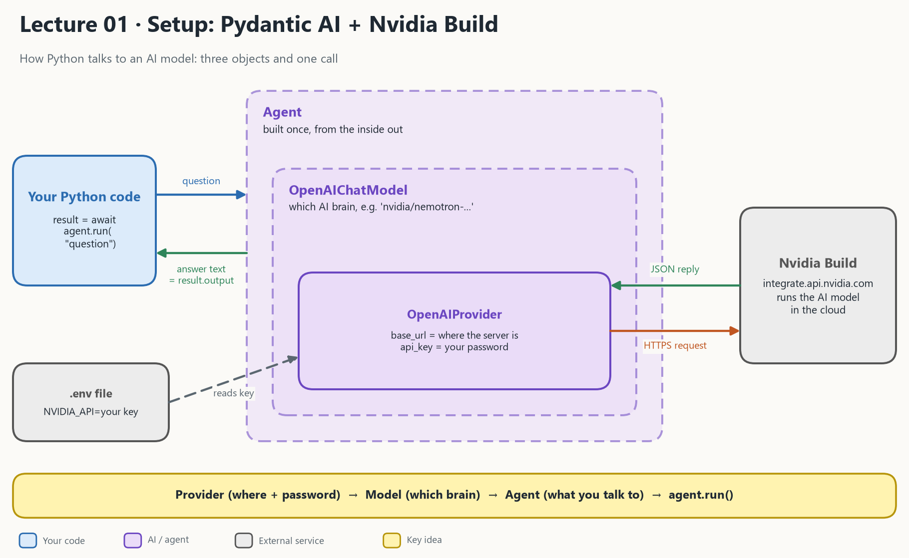

# Lecture 01: Setup Pydantic AI + Nvidia Build

**The goal:** make Python send a question to an AI model and get the answer back.

- [Setup video](https://youtu.be/_wzRJde6r5M)
- [Nvidia models](https://build.nvidia.com/models)



## 1. What the picture says

An AI model is too big to run on your laptop, so Nvidia runs it on their servers and you call it over the internet. Pydantic AI hides the web request behind **three objects and one call**.

| In the picture | In the code | Plain meaning |
| --- | --- | --- |
| **OpenAIProvider** | `OpenAIProvider(base_url=..., api_key=...)` | *Where* the server is, and your password |
| **OpenAIChatModel** | `OpenAIChatModel(model_name, provider=...)` | *Which* AI brain, reached through that provider |
| **Agent** | `Agent(model)` | The thing you talk to. It wraps the model. |
| **Your Python code** | `await agent.run("question")` | Sends the question |
| **`result.output`** | the return value | The answer as a plain Python string |
| **.env file** | `NVIDIA_API=...` | Keeps the key out of your code. `load_dotenv()` reads it. |
| **Nvidia Build** | `https://integrate.api.nvidia.com/v1` | The cloud service that runs the model |

The three objects are built **once**, from the inside out (Provider, then Model, then Agent). After that, every question is one `agent.run(...)` call.

> **Data engineer view:** this is a REST API call. `base_url` is the host, `api_key` is the `Authorization` header, and the model name is a field in the JSON body. Pydantic AI builds the request and parses the response for you.

## 2. Where lecture 01 fits in the course

This is the first step. Every later lecture adds one idea to this one `agent.run(...)` call.

| Lecture | Idea added on top |
| --- | --- |
| **01 Setup** (this one) | Provider + Model + Agent, one question and one answer |
| 02 LLM intro | System prompt, messages, tokens, temperature |
| 03 Structured output | The answer is a validated Python object, not text |
| 04 Pydantic + FastAPI | The agent sits behind a web address |
| 05 Chatbot | Memory, and a web page in front |
| 06 Tool use | The model can call your functions |
| 07 Multi-agent handoff | A tool can be another agent |

## 3. What happens when you run it

| Step | What happens |
| --- | --- |
| 1 | `load_dotenv()` puts `NVIDIA_API` from `.env` into the environment |
| 2 | You build the Provider, then the Model, then the Agent |
| 3 | `await agent.run("Tell a joke")` sends one HTTPS request to Nvidia |
| 4 | Nvidia runs the model and sends JSON back |
| 5 | Pydantic AI unpacks it. You read the text in `result.output`. |

The notebook then shows three experiments:
- passing `model=...` to `run` changes the model for **that one call only**
- the model **hallucinates** when asked about Pydantic AI itself (it does not know the library)
- saving the answer to a file can fail on Windows with `UnicodeEncodeError` unless you open the file with `encoding="utf-8"`

## 4. What is in this folder

| File | What it is |
| --- | --- |
| [pydanticai_nvidia.ipynb](pydanticai_nvidia.ipynb) | The lecture notebook: builds the three objects and asks questions |
| [STUDY_GUIDE.md](STUDY_GUIDE.md) | Cell-by-cell explanation to read next to the notebook |
| [architecture_01.png](architecture_01.png) | The diagram at the top |

## 5. Github repo and uv

First you set up an empty GitHub repository, clone it, and create the Python environment with the package manager **uv**.

> [!NOTE]
> If you don't have uv installed, run `pip install uv`.

1. Create a GitHub repository.
2. Clone it to your computer with git bash or a terminal.
3. Create a new uv project:

```bash
uv init --no-package --python 3.13
```

It creates:

```
├── .gitignore
├── .python-version
├── README.md
├── main.py
├── pyproject.toml
└── uv.lock
```

4. Install the packages. Check `pyproject.toml` afterwards:

```bash
uv add pandas pydantic-ai ipykernel duckdb fastapi matplotlib python-dotenv streamlit uvicorn
```

Lecture 01 only needs `pydantic-ai`, `python-dotenv` and `ipykernel`. The rest are installed now because the whole course shares one environment (see the table in [STUDY_GUIDE.md](STUDY_GUIDE.md), section 3).

5. Create a `.env` file in the repo root with your key from [Nvidia Build](https://build.nvidia.com/models):

```
NVIDIA_API=your_key_here
```

> `.gitignore` already lists `.env`, so the key is not uploaded to GitHub.

## 6. Terminology

| Term | Meaning |
| --- | --- |
| `pyproject.toml` | Metadata about your project, including the package list |
| `uv.lock` | The exact version of every package, like a more precise `requirements.txt` |
| `.venv` | A virtual environment, isolated from the rest of your system |
| `.python-version` | The project's default Python version |
| `uv run <command>` | Runs a command in the project, e.g. `uv run python script.py` |
| `uv init` | Creates a Python project (makes `pyproject.toml`) |
| `uv add <package>` | Adds a dependency and installs it |
| `uv add --dev <package>` | Adds a development-only dependency |
| `uv remove <package>` | Removes a dependency |
| `uv sync` | Makes the environment match `pyproject.toml` |
| `uv python install` | Installs a Python version |
| `uv python list` | Lists available Python versions |

## Read more

- [uv on github](https://github.com/astral-sh/uv)
- [STUDY_GUIDE.md](STUDY_GUIDE.md): the explanation for this lecture
- Next: [Lecture 02 LLM intro](../02_llm_intro/README.md)

## Other videos 📹

- [python setup](https://www.youtube.com/watch?v=dteU94PSNoQ&t=90s)
- [python setup when it doesn't work](https://www.youtube.com/watch?v=Lkr6yRUCHbA&t=204s)
