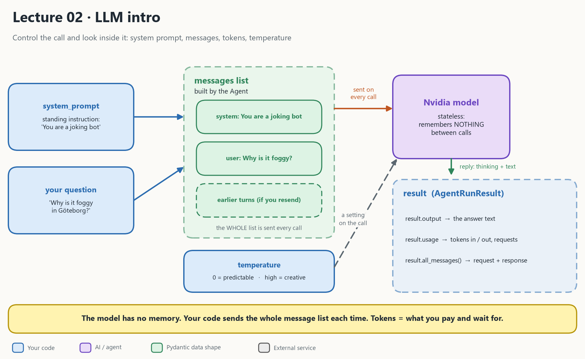

# Lecture 02: LLM intro

Lecture 01 gave you a phone line to the AI. Lecture 02 teaches you to **control** the call and **look inside** it.



## 1. What the picture says

| In the picture | In the code | Plain meaning |
| --- | --- | --- |
| **system_prompt** | `Agent(model, system_prompt="...")` | A standing instruction that shapes every answer |
| **your question** | `agent.run("Why is it foggy...")` | The user prompt |
| **messages list** | `result.all_messages()` | What is really sent: system message(s), the question, and any earlier turns |
| **temperature** | `ModelSettings(temperature=...)` | A dial from predictable (0) to creative (high). It is a setting on the call, not part of the messages. |
| **Nvidia model** | the same model object as lecture 01 | Stateless: it **remembers nothing** between calls |
| **result** | `AgentRunResult` | One object with the answer, the cost and the messages |

The most important sentence in this lecture:

> The model has no memory. If you want a conversation, your code must send the earlier messages again each time.

Lecture 05 builds a real chatbot on exactly this idea.

## 2. How 02 differs from 01

| | **01 Setup** | **02 LLM intro** |
| --- | --- | --- |
| Question | How do I call the model? | How do I **control** it and **inspect** it? |
| What you send | One question | A message list: system prompt + question |
| What you read | `result.output` | `.output`, `.usage` (tokens), `.all_messages()` |
| Steering the answer | Not yet | `system_prompt`, prompt wording, `temperature` |

## 3. The five ideas

| Idea | One sentence | Where in the notebook |
| --- | --- | --- |
| **System prompt** | A standing instruction, like "You are a joking programming bot" | The main cell |
| **Messages** | A conversation is a list of messages you can inspect | "Check the messages" |
| **Tokens** | The unit the model reads and writes, and the unit you pay and wait for | "Analyze tokens" |
| **Temperature** | `0` gives the same kind of story every time, `1.5` gets odd and creative | "Temperature" |
| **Multimodal** | Input can be more than text (images), if the model supports it. This model is text-only, so that cell is written as markdown, not run. | "Multimodal inputs" |

Plus a first taste of **prompt engineering**: the "chef bot" follows the *format* you ask for, but it only partly follows the *content*. A prompt controls shape well and truth poorly. That is why the course later adds evaluation and hallucination detection.

## 4. What is in the result

```
result  (AgentRunResult)
 ├── output ────────────► the answer text
 ├── usage ─────────────► input_tokens, output_tokens, requests
 └── all_messages() ────► [ request (system + user parts),  response (thinking + text parts) ]
```

A reasoning model may spend many hidden "thinking" tokens even on a tiny question. The usage numbers in the notebook show this.

## 5. What is in this folder

| File | What it is |
| --- | --- |
| [llm_intro.ipynb](llm_intro.ipynb) | The lecture notebook |
| [STUDY_GUIDE.md](STUDY_GUIDE.md) | Cell-by-cell explanation to read next to the notebook |
| [architecture_02.png](architecture_02.png) | The diagram at the top |
| [kokchun.png](kokchun.png) | An image file in the folder (I did not find it used by the notebook code) |

## 6. Run it

This lecture is a notebook, so there is nothing to start in a terminal.

1. Open [llm_intro.ipynb](llm_intro.ipynb) in VS Code and select the project's `.venv` as the kernel.
2. Make sure the repo root has a `.env` with `NVIDIA_API=...` (see [Lecture 01](../01_setup_pydantic_nvidia_build/README.md)).
3. Choose **Restart, then Run All**. The cell numbers in the study guide match that order.

> The notebook reuses names like `agent`, `prompt` and `result`. A later cell replaces the joke agent with a new one, so run top to bottom.

## Read more

- [STUDY_GUIDE.md](STUDY_GUIDE.md): the explanation for this lecture
- Previous: [Lecture 01 Setup](../01_setup_pydantic_nvidia_build/README.md)
- Next: [Lecture 03 Structured output](../03_pydanticai_structured_output/README.md)
