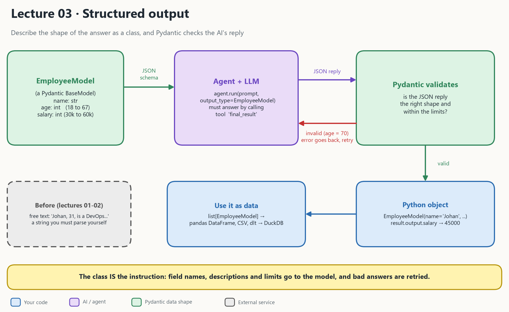

# Lecture 03: Structured output with Pydantic

In lectures 01 and 02 the answer came back as **text**. Text is hard to use in a program. Lecture 03 makes the answer a **validated Python object**.

- [Lecture video](https://youtu.be/VZv0tzrhvHw)

## 1. What the picture says

You describe the shape of the answer as a class. Pydantic AI makes the model fill in that shape, and Pydantic **checks** it.

| In the picture | In the code | Plain meaning |
| --- | --- | --- |
| **EmployeeModel** | `class EmployeeModel(BaseModel)` with `Field(...)` | The shape: field names, types and limits (like a table schema) |
| **Agent + LLM** | `agent.run(prompt, output_type=EmployeeModel)` | Sends the shape to the model as a tool named `final_result`. The model must answer by calling it. |
| **JSON schema** | built from your class | The field names, descriptions and limits become part of the prompt |
| **Pydantic validates** | automatic | Is the JSON reply the right shape and within the limits (`ge`, `le`, `gt`, `lt`)? |
| **invalid, retry** | automatic | The error is sent back to the model and it tries again (1 retry by default) |
| **Python object** | `result.output` | A real `EmployeeModel`, so `result.output.salary` is a number |
| **Use it as data** | `output_type=list[EmployeeModel]`, `model_dump()`, pandas, dlt | Rows for a DataFrame, a CSV or DuckDB |

> **Data engineer view:** `EmployeeModel` is a table schema, `output_type=` says "return rows that fit this schema", and Pydantic is the validation step. It works like a data contract between the LLM and your code.

## 2. How 03 differs from 01 and 02

| | **01 Setup** | **02 LLM intro** | **03 Structured output** |
| --- | --- | --- | --- |
| What comes back | A string | A string (plus usage and messages) | **A Python object** |
| How you control the answer | Not yet | `system_prompt`, prompt wording | **A class** with types and limits |
| Bad answers | You read them yourself | You read them yourself | **Validated**, and retried automatically |
| Using the answer | Print it | Print it | `result.output.salary`, a DataFrame, DuckDB |
| Cost of a bad answer | n/a | n/a | An extra model call per retry |

The step from 02 to 03: instead of *asking for a format in words*, you *give the model a class*.

## 3. The notebooks in this folder

The folder holds three notebooks. They tell the same story with different extras.

| Notebook | What it covers | Guide |
| --- | --- | --- |
| [lecture_pydanticai_pydantic_models.ipynb](lecture_pydanticai_pydantic_models.ipynb) | The main lecture, in Swedish: free text, then `BaseModel`, then `output_type`, then many employees, mean salary, DataFrame, chart | [STUDY_GUIDE_lecture_pydanticai_pydantic_models.md](STUDY_GUIDE_lecture_pydanticai_pydantic_models.md) |
| [pydanticai_pydantic_model.ipynb](pydanticai_pydantic_model.ipynb) | Same core, plus **nested models** (`CvModel` with lists of experiences and educations) and loading them into DuckDB with `dlt` | [STUDY_GUIDE_pydanticai_pydantic_model.md](STUDY_GUIDE_pydanticai_pydantic_model.md) |
| [structured_output_exercise.ipynb](structured_output_exercise.ipynb) | The exercise: summarize a text into `Resilience` and `Person` models | [STUDY_GUIDE_strctured_output_exercise.md](STUDY_GUIDE_strctured_output_exercise.md) (whole folder) |

The whole-folder guide is the best place to start. It also explains the bug in the exercise: `Field("text")` sets a **default value**, not a description. Use `Field(description="text")`.

## 4. What is in this folder

| File | What it is |
| --- | --- |
| [model.py](model.py) | `nvidia_model()`: the Nvidia connection from lecture 01 as a function |
| [employees.csv](employees.csv) | Sample employee data (`name, age, salary, role, description`) |
| The three notebooks and guides | See the table above |
| [architecture_03.png](architecture_03.png) | The diagram at the top |

## 5. Run it

This lecture is notebooks only.

1. Open a notebook in VS Code and select the project's `.venv` kernel.
2. Put `NVIDIA_API=...` in the repo's `.env` (see [Lecture 01](../01_setup_pydantic_nvidia_build/README.md)).
3. **Restart, then Run All**.

Only `pydanticai_pydantic_model.ipynb` cells `[18]` to `[23]` need a new package: run `uv add dlt` first. They are marked optional.

> [!Note]
> In the video the lecturer used Gemini, but the original code here used the OpenRouter API. If you want a free API, Gemini is quite limited and easy to hit the limit with. OpenRouter lets you experiment more before reaching the limit. [model.py](model.py) in this folder builds the Nvidia connection used here.

> [!NOTE]
> Models come and go quickly in OpenRouter. Some change their billing or get rate limited upstream. The easiest fix is to check for another model and use that.

## Read more

- [Pydantic docs](https://docs.pydantic.dev/latest/)
- Previous: [Lecture 02 LLM intro](../02_llm_intro/README.md)
- Next: [Lecture 04 Pydantic + FastAPI](../04_pydantic_fastapi/README.md)
