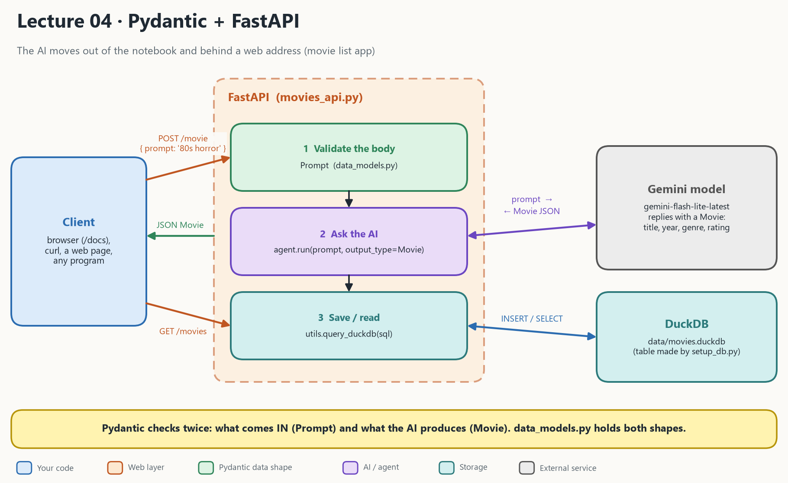

# Lecture 04: PydanticAI + FastAPI

Until now the AI lived inside a notebook, so only you could use it. Lecture 04 puts it **behind a web address**, so any program (a web page, another service, a script) can use it by sending a request.

- [Lecture video](https://youtu.be/mp650k5T2T8)



The lecturer's own sketch of the same system is [04_pydantic_fastapi.png](04_pydantic_fastapi.png): backend (Pydantic, PydanticAI, DuckDB), an API layer (FastAPI) and a frontend (Streamlit).

## 1. What the picture says

The example app is a movie list with two endpoints.

| Endpoint | What it does |
| --- | --- |
| `GET /movies` | Returns the movies stored in the database |
| `POST /movie` | Takes `{"prompt": "a famous 80s horror movie"}`, asks the AI for a **structured** `Movie`, saves it, and returns it |

| In the picture | In the code | Plain meaning |
| --- | --- | --- |
| **Client** | browser `/docs`, curl, any program | Sends HTTP requests |
| **FastAPI** | [src/movies_api.py](src/movies_api.py) | The web app. Each endpoint is a function. |
| **1 Validate the body** | `Prompt` in [src/data_models.py](src/data_models.py) | A wrong request shape gets an automatic `422` error before your code runs |
| **2 Ask the AI** | `agent.run(prompt, output_type=Movie)` | The model must answer with title, year, genre, rating (1 to 5) |
| **3 Save / read** | `query_duckdb(sql)` in [src/utils.py](src/utils.py) | Runs the SQL against the database |
| **Gemini model** | `google:gemini-flash-lite-latest` | The AI, over the internet |
| **DuckDB** | `data/movies.duckdb` | A single database file. The table is made by [src/setup_db.py](src/setup_db.py). |

Pydantic checks **twice** in one request: what comes **in** (`Prompt`) and what the **AI produces** (`Movie`). This is a tiny pipeline: request in, LLM as a transform step, validated row, `INSERT`, row out.

## 2. How 04 differs from 03

| | **03 Structured output** | **04 Pydantic + FastAPI** |
| --- | --- | --- |
| Where the AI runs | In a notebook, for you only | **Behind a URL**, for any program |
| Output shape | `output_type=EmployeeModel` | `output_type=Movie` (the same idea) |
| New pieces | None | **FastAPI** (web layer) and **DuckDB** (storage) |
| Pydantic is used for | The AI's answer | The AI's answer **and** the incoming request |
| API key | Stays in your notebook | Stays on the server, callers never see it |
| Model | Nvidia, through `model.py` | Google Gemini, as a model string |

## 3. What happens on `POST /movie`

| Step | What happens |
| --- | --- |
| 1 | You send `POST /movie` with `{"prompt": "a famous 80s horror movie"}` |
| 2 | FastAPI checks the body against `Prompt`. Wrong shape: automatic `422`. |
| 3 | `agent.run(prompt, output_type=Movie)` asks the model. A rating outside 1 to 5 is sent back to the model for a retry. |
| 4 | `INSERT INTO movies VALUES (...)` saves the validated movie |
| 5 | FastAPI turns the `Movie` into JSON and returns it |

## 4. What is in this folder

| File | What it is |
| --- | --- |
| [src/movies_api.py](src/movies_api.py) | The FastAPI app. **The file you run.** |
| [src/data_models.py](src/data_models.py) | `Movie` and `Prompt`: the shapes |
| [src/utils.py](src/utils.py) | `query_duckdb()`: one function to run SQL |
| [src/setup_db.py](src/setup_db.py) | Creates the `movies` table. Run once. |
| [data/movies.duckdb](data/movies.duckdb) | The database file |
| [STUDY_GUIDE.md](STUDY_GUIDE.md) | Explanation to read next to the code |
| [architecture_04.png](architecture_04.png) | The diagram at the top |
| [04_pydantic_fastapi.png](04_pydantic_fastapi.png) | The lecturer's sketch |

## 5. Run it

**1. Dependencies.** Already installed by lecture 01. If something is missing:

```bash
uv add uvicorn fastapi duckdb python-dotenv
```

You also need `pydantic-ai` in the project.

**2. A Google API key.** Get one at [Google AI Studio](https://aistudio.google.com/docs/api-key) and put it in the repo's `.env`. Pydantic AI reads `GOOGLE_API_KEY` (or `GEMINI_API_KEY`).

**3. Start the server from inside `src/`**, because `movies_api.py` imports `utils` and `data_models` from the current folder:

```bash
cd 04_pydantic_fastapi/src
```

```bash
uv run python setup_db.py
```

```bash
uv run uvicorn movies_api:app --reload
```

`setup_db.py` is needed once, and the database file already exists.

| Open in the browser | What you see |
| --- | --- |
| `http://127.0.0.1:8000/movies` | The movies as JSON |
| `http://127.0.0.1:8000/docs` | FastAPI's test page. Open `POST /movie`, click **Try it out**, send `{"prompt": "a famous 80s horror movie"}`. |

> [!Note]
> In the video the lecturer used Gemini, but the original code here used the OpenRouter API. Gemini's free tier is limited and easy to hit. OpenRouter lets you experiment more before reaching the limit. The code in this folder now uses `google:gemini-flash-lite-latest`.

> [!NOTE]
> Models come and go quickly in OpenRouter. Some change their billing or get rate limited upstream. The easiest fix is to check for another model and use that.

## Read more

- [Pydantic docs](https://docs.pydantic.dev/latest/)
- [STUDY_GUIDE.md](STUDY_GUIDE.md): the explanation for this lecture
- Previous: [Lecture 03 Structured output](../03_pydanticai_structured_output/README.md)
- Next: [Lecture 05 Chatbot](../05_pydanticai_fastapi_chatbot/README.md)
