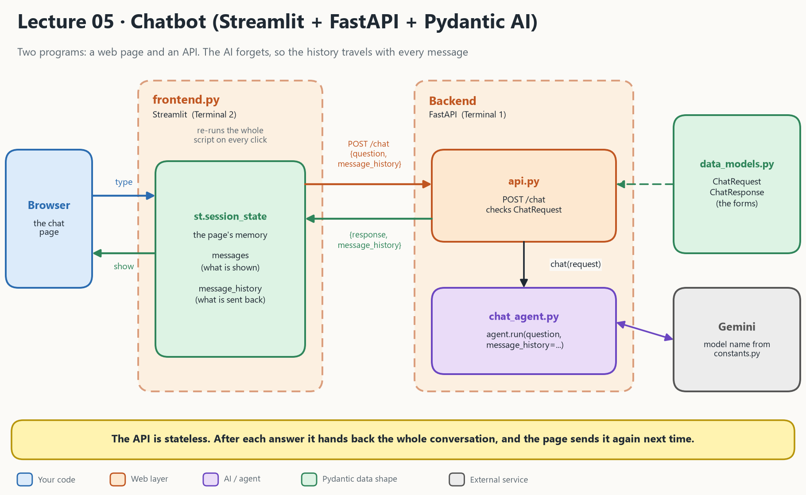

# Lecture 05: Fullstack chatbot (PydanticAI + FastAPI + Streamlit)

Lecture 04 put an AI behind a web address. Lecture 05 builds a **chatbot** with it: a web page where you type, and a bot that remembers what you said earlier.

- [Video: Building a fullstack chatbot with FastAPI + PydanticAI + Streamlit](https://youtu.be/sGR2DCstveY)



## 1. What the picture says

There are **two programs** running at the same time, in two terminals.

| In the picture | File | Job | Knows about the AI? |
| --- | --- | --- | --- |
| **frontend.py** (Streamlit) | [frontend.py](frontend.py) | Draws the chat, sends what you type to the API | No |
| **api.py** (FastAPI) | [api.py](api.py) | Receives `POST /chat`, checks the request shape | No, it calls the agent |
| **chat_agent.py** | [chat_agent.py](chat_agent.py) | Holds the agent and the `chat()` function | **Yes** |
| **data_models.py** | [data_models.py](data_models.py) | `ChatRequest` and `ChatResponse`, the "forms" both sides agree on | No |
| **constants.py** | [constants.py](constants.py) | The model name (`MODEL_SMALL = "google:gemini-flash-lite-latest"`) | No |
| **st.session_state** | inside `frontend.py` | The page's memory: `messages` (shown) and `message_history` (sent back) | No |

The frontend never imports the agent. It only knows the address `http://127.0.0.1:8000/chat` and the field names.

> **The one idea that makes it a chatbot:** the AI remembers nothing (lecture 02). So after every answer the backend hands back the whole conversation, the page stores it, and sends it again with the next question. The API itself stores nothing.

## 2. How 05 differs from 04 and 06

| | **04 Pydantic + FastAPI** | **05 Chatbot** | **06 Tool use** |
| --- | --- | --- | --- |
| Number of agents | 1 | 1 | 1 |
| New idea | Put the AI behind a URL | **Memory** (`message_history`) and a **web page** | Functions the model can call |
| Programs running | 1 (the API) | **2** (API + Streamlit page) | 1 (a script) |
| Who keeps state | Database (DuckDB) | **The browser tab** (`st.session_state`) | Nothing |
| Output | A structured `Movie` | Plain text reply | Text, built from tool results |
| Pydantic is used for | `Movie`, `Prompt` | `ChatRequest`, `ChatResponse` | `deps` (a dataclass) |

```
04  Client ──► FastAPI ──► agent ──► DuckDB
05  Browser ──► Streamlit ──► FastAPI ──► agent         (+ history goes back and forth)
06  main.py ──► agent ⇄ tools (your functions)
```

## 3. What happens on one message

| Step | Where | What happens |
| --- | --- | --- |
| 1 | Browser | You type "what did I ask first?" |
| 2 | `frontend.py` | POSTs `{"question": "...", "message_history": [...earlier messages...]}` |
| 3 | `api.py` | FastAPI checks the JSON against `ChatRequest`. Wrong shape: `422`, nothing else runs. |
| 4 | `api.py` | Calls `chat(request)` in `chat_agent.py` |
| 5 | `chat_agent.py` | `agent.run(question, message_history=history)` asks Gemini |
| 6 | `chat_agent.py` | Returns `ChatResponse(response=text, message_history=result.all_messages())` |
| 7 | `frontend.py` | Shows `response` and stores the new `message_history` for next time |

The history grows by **two messages every turn**, so a long chat sends more tokens each time (more cost, more waiting). The system prompt appears once, in the first request.

## 4. What is in this folder

| File | What it is |
| --- | --- |
| [frontend.py](frontend.py) | The Streamlit chat page. **Run this second.** |
| [api.py](api.py) | The FastAPI backend with `POST /chat`. **Run this first.** |
| [chat_agent.py](chat_agent.py) | The agent (a joking programming bot) and `chat()` |
| [data_models.py](data_models.py) | `ChatRequest` and `ChatResponse` |
| [constants.py](constants.py) | Model names: small, medium and large |
| [chat_eda.ipynb](chat_eda.ipynb) | A notebook for exploring the same things by hand |
| [STUDY_GUIDE.md](STUDY_GUIDE.md) | Explanation to read next to the code |
| [architecture_05.png](architecture_05.png) | The diagram at the top |

## 5. Run it

**A Google API key.** Get one at [Google AI Studio](https://aistudio.google.com/docs/api-key) and put it in the repo's `.env` (`GOOGLE_API_KEY` or `GEMINI_API_KEY`).

Use **two terminals**, both inside this folder:

```bash
cd 05_pydanticai_fastapi_chatbot
```

Terminal 1, the backend (start it first):

```bash
uv run uvicorn api:app --reload
```

Terminal 2, the page:

```bash
uv run streamlit run frontend.py
```

| Check | Address |
| --- | --- |
| Backend test page | `http://127.0.0.1:8000/docs` |
| The chat page | The address Streamlit prints, usually `http://localhost:8501` |

> The old README lists `http://127.0.0.1:8000/chat`. Do not open it in the browser. The browser sends a GET, and `/chat` only accepts POST, so you get `405 Method Not Allowed`. Use `/docs` and **Try it out**, or the chat page.

## Read more

- [PydanticAI and FastAPI chat app example](https://ai.pydantic.dev/examples/chat-app/)
- [STUDY_GUIDE.md](STUDY_GUIDE.md): the explanation for this lecture
- Previous: [Lecture 04 Pydantic + FastAPI](../04_pydantic_fastapi/README.md)
- Next: [Lecture 06 Tool use](../06_tool_use/README.md)

## Other videos

These videos show a version where the chatbot backend and frontend are tightly coupled. In the main video above they are decoupled, with a FastAPI layer in between.

- [Video: Hands on building a chatbot with PydanticAI and Streamlit frontend](https://www.youtube.com/watch?v=fx0jIFbz8YM)
- [Video: Hands on building a chatbot with PydanticAI and Taipy](https://www.youtube.com/watch?v=svD4gk40pcg)
