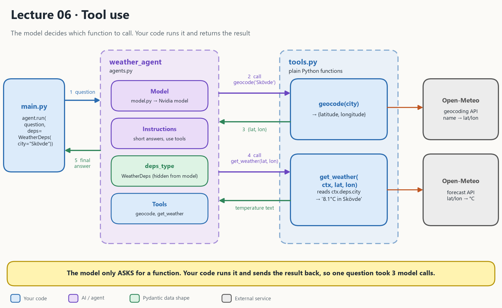

# Lecture 06: Tool use in PydanticAI

An LLM only produces **text**. It cannot look up today's weather or query a database. A **tool** fixes that: you write an ordinary Python function and tell the model "you may ask me to run this".

- [Video](https://youtu.be/4iFQ4YFhSIY)



## 1. What the picture says

The example asks "What is the weather in Skövde?". The weather API needs coordinates, people say city names, so there are two tools and the model **chains** them.

| In the picture | In the code | Plain meaning |
| --- | --- | --- |
| **main.py** | [main.py](main.py) | Asks the agent questions: `agent.run(question, deps=WeatherDeps(city="Skövde"))` |
| **weather_agent** | [agents.py](agents.py) | `Agent` = model + instructions + tools + `deps_type` |
| **Model** | [model.py](model.py) | `nvidia_model(...)`, the same helper as lecture 03 |
| **Instructions** | `instructions=(...)` in `agents.py` | Answer short, use the tools, decline non-weather questions (a guardrail written as a sentence) |
| **deps_type** | `WeatherDeps` in [tools.py](tools.py) | Extra data for the tools (the city). **Hidden from the model.** |
| **geocode(city)** | [tools.py](tools.py) | Turns a city name into latitude and longitude |
| **get_weather(ctx, lat, lon)** | [tools.py](tools.py) | Calls the forecast API and returns "Current temperature in Skövde is 8.1°C" |
| **Open-Meteo** | external web APIs | Free, no key needed |

> **The model is the decision-maker. Your code is the worker.** The model only *asks* for a function and picks the arguments. Your code runs it and sends the result back as text.

## 2. How 06 differs from 05 and 07

| | **05 Chatbot** | **06 Tool use** | **07 Multi-agent** |
| --- | --- | --- | --- |
| Number of agents | 1 | 1 | 3 |
| New idea | Memory and a web page | **Tools**: the model can call functions | **Delegation**: a tool can be another agent |
| Where the answer comes from | The model alone | The model plus **real data** from your functions | The coach, built from several experts' answers |
| What a tool does | No tools | Calls a web API (`geocode`, `get_weather`) | Calls another agent, or runs Python |
| Extra data for the run | None | `deps=WeatherDeps(city=...)` | `deps=ClientDeps(...)` shared with all agents |
| Around the agent | FastAPI + Streamlit | A script | A script |
| Cost of one question | 1 model call | **3 model calls** here | 5 in a real run |

```
05  You ──► agent                              remembers the conversation
06  You ──► agent ⇄ your functions ──► APIs    gets real data
07  You ──► coach ⇄ [study agent, career agent, export function]
```

## 3. The tool loop

For "What is the weather in Skövde?" the model is called **three times**:

| Step | Who | What happens |
| --- | --- | --- |
| 1 | `main.py` | Sends the question |
| 2 | Model call 1 | Does not write text. Asks to call `geocode(city="Skövde")`. |
| 3 | Your code | Runs `geocode`, which returns `{latitude, longitude}` |
| 4 | Model call 2 | Asks to call `get_weather(lat, lon)` |
| 5 | Your code | Runs `get_weather` and returns the temperature text |
| 6 | Model call 3 | Writes the final answer in words |

Nobody wrote code that says "call geocode first". The model worked that out from the **tool descriptions**, which come from the function **name**, the **parameters** and the **docstring**. That is why the docstring on `get_weather` matters. The `ctx` parameter is not shown to the model.

## 4. What is in this folder

| File | What it is |
| --- | --- |
| [main.py](main.py) | The script you run. Asks a weather question, then an off-topic one to test the guardrail. |
| [agents.py](agents.py) | Builds `weather_agent` (builds it, runs nothing) |
| [tools.py](tools.py) | `WeatherDeps`, `get_weather` and `geocode` |
| [model.py](model.py) | `nvidia_model()` |
| [deps.py](deps.py) | A copy of `WeatherDeps` that nothing imports (see quirks) |
| [tools_basics.ipynb](tools_basics.ipynb) | A smaller notebook: a dice game with `@agent.tool` and `@agent.tool_plain` decorators |
| [STUDY_GUIDE.md](STUDY_GUIDE.md) | Explanation to read next to the code |
| [architecture_06.png](architecture_06.png) | The diagram at the top |

How the code files import each other:

```
model.py ──┐
           ▼
tools.py ──► agents.py ──► main.py      ◄── you run this one
```

## 5. Run it

**1. A key.** The repo's `.env` needs `NVIDIA_API=...` (see [Lecture 01](../01_setup_pydantic_nvidia_build/README.md)). The Open-Meteo weather APIs need no key.

**2. Run from inside this folder**, because `main.py` imports `agents.py` from the current folder:

```bash
cd 06_tool_use
```

```bash
uv run main.py
```

You should see the temperature for Skövde, then a polite refusal of the programming-joke question.

## 6. Known quirks

| Quirk | Where | Effect |
| --- | --- | --- |
| `geocode` has no docstring | [tools.py](tools.py) | The model sees only its name and one parameter. It works, but a docstring would help. |
| An unknown city crashes | [tools.py](tools.py) | `geocode` takes `results[0]`, so a missing city raises an error |
| `deps.py` is unused | [deps.py](deps.py) | `agents.py` and `main.py` import `WeatherDeps` from `tools.py`, so editing `deps.py` changes nothing |
| The weather text uses `ctx.deps.city` | [tools.py](tools.py) | The city in the reply comes from `deps`, not from the coordinates the model chose |
| The guardrail is only a sentence | [agents.py](agents.py) | A determined user might still talk the model into off-topic answers |

More detail is in the [STUDY_GUIDE.md](STUDY_GUIDE.md).

## Read more

- [STUDY_GUIDE.md](STUDY_GUIDE.md): the explanation for this lecture
- Previous: [Lecture 05 Chatbot](../05_pydanticai_fastapi_chatbot/README.md)
- Next: [Lecture 07 Multi-agent handoff](../07_multiagent_handoff/README.md)
