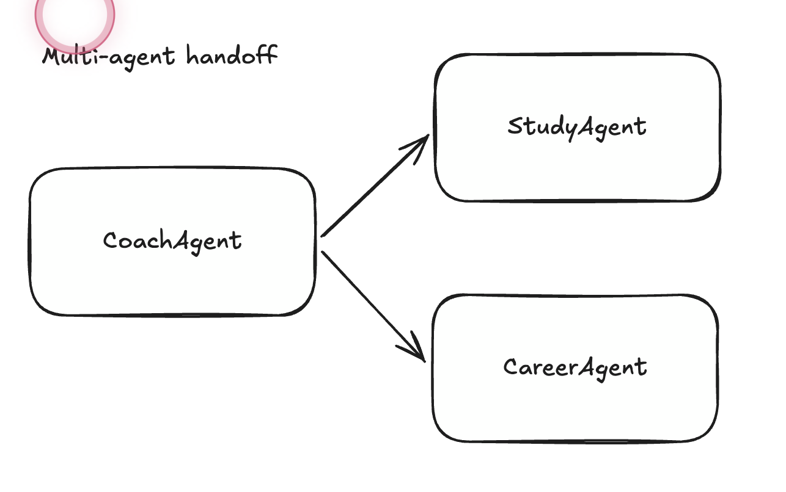

# Multi-agent handoff in PydanticAI

One agent receives a question and, instead of answering alone, **hands parts of it to more specialised agents**, then combines their answers.



## 1. What the picture says

The picture has three boxes and two arrows. Here is how each part maps to this folder:

| In the picture | In the code | Job |
| --- | --- | --- |
| **CoachAgent** | `coach_agent` in [agents.py](agents.py) | The manager. The only agent that talks to the user. Decides who to ask and combines the answers. |
| **StudyAgent** | `study_agent` in [agents.py](agents.py) | Expert in study plans and learning techniques |
| **CareerAgent** | `career_agent` in [agents.py](agents.py) | Expert in jobs, resumes and career paths |
| **Arrow** (Coach → expert) | a **tool**: `ask_study_agent`, `ask_career_agent` | A normal Python function that calls the other agent and returns its answer as text |

Two things the picture leaves out:
- The answers travel **back** along the arrows. The coach reads them and writes the final reply.
- The coach has a third tool, `export_report`, that saves the final text to `exports/`.

> **Why do this?** Each agent gets a short, focused prompt and is an "expert" in one area. For simple problems one agent is often enough, and this setup costs more (see section 5), so you should check that splitting is worth it.

## 2. How 07 is different from 05 and 06

Each lecture adds one idea to the previous one. The picture at the top shows 07. The diagram below puts it next to 05 and 06:

```
05  Chatbot            You ──► [ one agent ] ──► answer
                                 remembers the earlier messages
                                 wrapped in FastAPI + Streamlit

06  Tool use           You ──► [ one agent ] ──► answer
                                 │
                                 └── calls Python functions (get_weather, geocode)

07  Multi-agent        You ──► [ coach agent ] ──► answer
                                 │
                                 ├── calls study_agent   ◄── another AI, own prompt
                                 ├── calls career_agent  ◄── another AI, own prompt
                                 └── calls export_report (a normal Python function)
```

| | **05 Chatbot** | **06 Tool use** | **07 Multi-agent** |
| --- | --- | --- | --- |
| Number of agents | 1 | 1 | **3** |
| New idea | **Memory**: send earlier messages back with each question | **Tools**: the model can ask your code to run functions | **Delegation**: a tool can be *another agent* |
| What a tool does | No tools | Calls a web API or runs Python (`get_weather`) | Calls another agent (`ask_study_agent`), or runs Python (`export_report`) |
| Where the answer comes from | The model alone | The model plus real data from your functions | The coach, built from several experts' answers |
| Extra data given to the run | None | `deps=WeatherDeps(city=...)` | `deps=ClientDeps(name=..., ...)` shared with **all** agents |
| Around the agent | FastAPI + Streamlit | Just a script | Just a script |
| Model provider | Google (model name string) | Nvidia | Nvidia |
| Main file | `chat_agent.py` | `agents.py` + `tools.py` | [agents.py](agents.py) |

**In one sentence each:**
- **05:** one agent that *remembers* the conversation.
- **06:** one agent that can *use functions* to reach outside data.
- **07:** an agent that can *use other agents* the same way it uses functions.

The step from 06 to 07 is small. The tool function in 06 contains a web call, and the tool function in 07 contains `study_agent.run(...)`. To the coach they look the same.

## 3. How a run works

What happens when you run [main.py](main.py) with the question *"I'm learning Python and want to become a data engineer. What should I do?"*:

| Step | Who | What happens |
| --- | --- | --- |
| 1 | [main.py](main.py) | Builds the client profile (`ClientDeps`) and calls `coach_agent.run(question, deps=client)` |
| 2 | Coach | Calls the tool `ask_study_agent` and writes the question for the expert |
| 3 | Study agent | A separate AI call: answers with a study plan, addressing the client by name |
| 4 | Coach | Calls the tool `ask_career_agent` |
| 5 | Career agent | A separate AI call: answers with career advice |
| 6 | Coach | Combines both answers into one short response |
| 7 | Coach | Calls `export_report`, which writes `exports/<name>_<timestamp>.md` |
| 8 | [main.py](main.py) | Prints the coach's final reply |

The numbered steps are written in the coach's instructions in [agents.py](agents.py). The model is *asked* to follow them, but nothing in your Python code forces the order.

## 4. What is in this folder

| File | What it is | Read it when you want to know... |
| --- | --- | --- |
| [agents.py](agents.py) | The three agents, their instructions and the coach's three tools | How the handoff works. **The main file.** |
| [dependencies.py](dependencies.py) | `ClientDeps`: the client's name, goal, level, weekly hours and role | What data every agent can read |
| [model.py](model.py) | `nvidia_model()`: builds the connection to the Nvidia API | How the AI model is set up |
| [main.py](main.py) | The script you run. Creates a client and asks the coach one question. | How to start it |
| [multiagent_handoff.ipynb](multiagent_handoff.ipynb) | The whole system in one notebook cell | The lecture version of the same code |
| [STUDY_GUIDE.md](STUDY_GUIDE.md) | Step-by-step explanation to read next to the code | Anything you do not understand |
| [multi-agent.png](multi-agent.png) | The diagram at the top | |
| `exports/` | Folder where `export_report` saves the reports | |

How the code files import each other:

```
model.py ───────────┐
                    ▼
dependencies.py ──► agents.py ──► main.py      ◄── you run this one
```

## 5. Run it

**1. A key.** Create a `.env` file (in this folder or in the repo root) with:

```
NVIDIA_API=your_key_here
```

**2. Run from inside this folder**, because `main.py` imports `agents.py` and `exports/` is created relative to where you run Python:

```bash
cd 07_multiagent_handoff
```

```bash
uv run main.py
```

You should see the coach's short answer printed, and a new file in [exports/](exports/).

**What it costs:** one question made at least **6 model calls** in my test run (4 for the coach, 1 for each expert), compared with 1 to 3 in lectures 05 and 06. More agents means more calls, more time and more tokens.

## 6. Known quirks

| Quirk | Where | Effect |
| --- | --- | --- |
| Only `name` is ever used | [dependencies.py](dependencies.py) | `goal`, `experience_lvl`, `weekly_hours` and `current_role` are never read by any agent |
| `export_report` returns nothing | [agents.py](agents.py) | The coach cannot tell you where the file was saved |
| Trailing comma after the career string | [agents.py](agents.py) | `instructions` becomes a 1-item tuple. It still works, but it is probably a typo. |

More detail on each of these is in the [STUDY_GUIDE.md](STUDY_GUIDE.md), section 6.

## Read more

- [STUDY_GUIDE.md](STUDY_GUIDE.md): the explanation for this lecture
- [Lecture 06: Tool use](../06_tool_use/README.md) and its [STUDY_GUIDE.md](../06_tool_use/STUDY_GUIDE.md): the step before this one
- [Lecture 05: Chatbot](../05_pydanticai_fastapi_chatbot/README.md): the lecture before that
