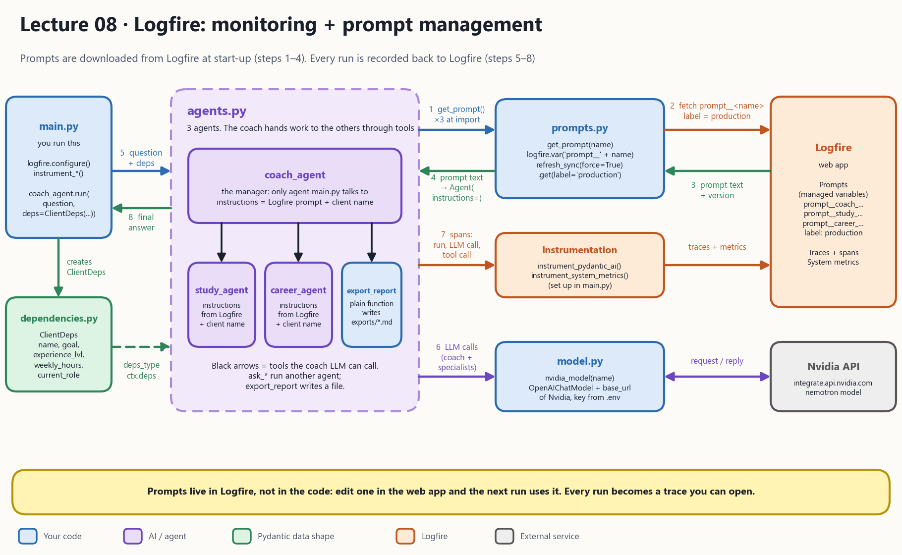

# Pydantic Logfire for Monitoring and Observability

**Part 1 - logging and prompt management**
- 
- [Pydantic Logfire Account](https://pydantic.dev/logfire)

<!-- **Part 2 - LLM judge** -->

The same three-agent coach from lecture 07, with two additions from **Logfire**: you can **see** everything the agents did (monitoring), and the agents' **prompts are stored in Logfire** instead of in the code (prompt management).



## 1. What the picture says

The numbers on the arrows are the order things happen in. Steps 1 to 4 happen **once, when the program starts**. Steps 5 to 8 happen **on every run**.

| In the picture | In the code | Job |
| --- | --- | --- |
| **main.py** | [main.py](main.py) | The script you run. Turns on Logfire, creates the client profile and asks the coach one question |
| **agents.py** | [agents.py](agents.py) | The coach, study and career agents and the coach's tools (the same design as 07) |
| **prompts.py** | [prompts.py](prompts.py) | `get_prompt()`: downloads one prompt from Logfire and returns it as a string |
| **Logfire** | the Logfire web app (outside your code) | Stores the prompts **and** receives the traces and metrics |
| **Instrumentation** | `logfire.instrument_pydantic_ai()` and `logfire.instrument_system_metrics()` in [main.py](main.py) | Watches the agents and sends what they do to Logfire |
| **model.py** | [model.py](model.py) | `nvidia_model()`: builds the connection to the Nvidia API |
| **dependencies.py** | [dependencies.py](dependencies.py) | `ClientDeps`: the client profile every agent can read |

> **Why do this?** An AI app is hard to debug: the answer changes every time, and one question can trigger several model calls and tool calls. Logfire records each step so you can look at what happened afterwards. Keeping prompts in Logfire lets you change an agent's behaviour without touching the code.

## 2. How 08 is different from 07

The agents, tools and the handoff are **identical**. Only two things change:

```
07  Multi-agent        You ──► [ coach agent ] ──► answer
                                 │   prompts are strings written inside agents.py
                                 ├── calls study_agent
                                 ├── calls career_agent
                                 └── calls export_report
                         (you can only see what happened by printing)

08  Logfire            You ──► [ coach agent ] ──► answer
                                 │   prompts are downloaded from Logfire at start-up
                                 ├── calls study_agent
                                 ├── calls career_agent
                                 └── calls export_report
                         every step is sent to Logfire as a trace
```

| | **07 Multi-agent** | **08 Logfire** |
| --- | --- | --- |
| Where the prompts live | Strings inside [agents.py](agents.py) | In Logfire. [agents.py](agents.py) calls `get_prompt("coach_agent_instructions")` |
| Changing a prompt | Edit the code and run again | Edit it in the Logfire web app. The next run picks it up |
| Seeing what happened | Only what you `print` | A **trace** in Logfire for every run, with every model call and tool call |
| Machine metrics (CPU, memory) | No | Yes, through `instrument_system_metrics()` |
| Extra files | None | [prompts.py](prompts.py) |
| Extra keys in `.env` | `NVIDIA_API` | `NVIDIA_API` **and** `LOGFIRE_PROMPTS` |
| Needs internet at start-up | Only for the model call | Also to download the three prompts |

**In one sentence each:**
- **Monitoring:** two lines in [main.py](main.py) make PydanticAI report every agent run, model request and tool call to Logfire. No change to the agents is needed.
- **Prompt management:** [prompts.py](prompts.py) asks Logfire for the text of each prompt, so prompts are data you can edit, not code.

## 3. The two Logfire features

| | **Monitoring (observability)** | **Prompt management** |
| --- | --- | --- |
| Question it answers | "What did my app just do, and how long did it take?" | "Which prompt text should this agent use right now?" |
| Direction | Your app **sends** data to Logfire | Your app **fetches** data from Logfire |
| Where in the code | [main.py](main.py): `logfire.configure()`, `instrument_pydantic_ai()`, `instrument_system_metrics()` | [prompts.py](prompts.py): `logfire.var(...)`, `refresh_sync()`, `.get(label=...)` |
| Key needed | Your Logfire login (`uv run logfire auth`) | `LOGFIRE_PROMPTS`, a key allowed to read variables |
| What you see in Logfire | Traces, spans and metrics | The prompts, their versions and labels |
| Steps in the picture | 7 | 1, 2, 3, 4 |

**Prompt names, versions and labels** (the words you will see in [prompts.py](prompts.py)):

| Word | Meaning | Example |
| --- | --- | --- |
| name | The variable's name in Logfire. The code adds the prefix `prompt__` | `prompt__coach_agent_instructions` |
| version | Each time you save a change, Logfire keeps it as a new version | `3` |
| label | A bookmark on a version, so you can test a new prompt without changing the live one | `production` |
| default | Text used if Logfire has no value for that variable | `"be a jokey assistant"` |

## Setup

Create an account and sign into [logfire](https://logfire-eu.pydantic.dev/login?from=%2Fsignup)

```bash
uv add logfire
uv run logfire auth
uv add "logfire[variables]"
uv add "logfire[system-metrics]"
uv add pydantic-ai-harness
```

## Concepts

- span - most atomic unit of work (name, start and duration) e.g. http request, database question, internal calculation
- trace - tree of spans -> parent/child path for one request
- metric - value measured over time e.g. latency, CPU load, queue length
- log - timestamped record of a single event with no duration

In this lecture one run of the coach is **one trace**. Inside it the spans form a tree:

```
trace: coach_agent run
 ├── span: model request (coach decides to call a tool)
 ├── span: tool call ask_study_agent
 │    └── span: study_agent run
 │         └── span: model request
 ├── span: tool call ask_career_agent
 │    └── span: career_agent run
 │         └── span: model request
 ├── span: model request (coach combines the answers)
 └── span: tool call export_report
```

The exact names in the Logfire web app may differ a little. The shape (a tree, with the specialists inside the coach's tool calls) is the point.

## 4. How a run works

What happens when you run [main.py](main.py). The step numbers are the ones on the arrows in the picture.

| Step | Who | What happens |
| --- | --- | --- |
| 1 | [agents.py](agents.py) | While it is being imported, it calls `get_prompt()` three times (coach, study, career) |
| 2 | [prompts.py](prompts.py) | Asks Logfire for `prompt__<name>` with the label `production` |
| 3 | Logfire | Sends back the prompt text and its version |
| 4 | [prompts.py](prompts.py) | Returns the text, and [agents.py](agents.py) gives it to `Agent(instructions=...)` |
| 5 | [main.py](main.py) | Builds the client profile (`ClientDeps`) and calls `coach_agent.run(question, deps=client)` |
| 6 | Coach, study and career agents | The coach calls `ask_study_agent` and `ask_career_agent` (each is another agent), combines the answers and calls `export_report`. All model calls go through [model.py](model.py) to the Nvidia API |
| 7 | Instrumentation | While step 6 runs, every agent run, model request and tool call is sent to Logfire as spans |
| 8 | [main.py](main.py) | Prints the coach's final reply. Open Logfire to see the trace |

Steps 1 to 4 happen before any of `main.py`'s own code runs, because `main.py` imports `agents.py` at the top, and `agents.py` calls `get_prompt()` as soon as it is imported.

## 5. What is in this folder

| File | What it is | Read it when you want to know... |
| --- | --- | --- |
| [main.py](main.py) | The script you run. Turns on Logfire, creates a client and asks the coach one question | How to start it and how monitoring is switched on |
| [agents.py](agents.py) | The three agents, their instructions and the coach's three tools | How the handoff works |
| [prompts.py](prompts.py) | `get_prompt()`: fetches a prompt from Logfire | How prompt management works. **New in 08** |
| [model.py](model.py) | `nvidia_model()`: builds the connection to the Nvidia API | How the AI model is set up |
| [dependencies.py](dependencies.py) | `ClientDeps`: the client's name, goal, level, weekly hours and role | What data every agent can read |
| [architecture_08.png](architecture_08.png) | The diagram at the top | |
| `exports/` | Folder where `export_report` saves the reports (created on the first run) | |

How the code files import each other:

```
model.py ───────────┐
dependencies.py ────┼──► agents.py ──► main.py      ◄── you run this one
prompts.py ─────────┘
```

## 6. Run it

**1. Logfire.** Follow [Setup](#setup) above, then in the Logfire web app create three prompts (managed variables) and give each version the label `production`:

```
prompt__coach_agent_instructions
prompt__study_agent_instructions
prompt__career_agent_instructions
```

You can copy the text from the instructions in [07_multiagent_handoff/agents.py](../07_multiagent_handoff/agents.py). If a prompt is missing, the code falls back to `"be a jokey assistant"` and the agent will behave strangely.

**2. Keys.** Create a `.env` file (in this folder or in the repo root) with:

```
NVIDIA_API=your_nvidia_key_here
LOGFIRE_PROMPTS=your_logfire_key_here
```

`LOGFIRE_PROMPTS` is a Logfire API key that is allowed to read variables (the scope is `project:read_variables`).

**3. Run from inside this folder**, because `main.py` imports `agents.py` and `exports/` is created relative to where you run Python:

```bash
cd 08_logfire
```

```bash
uv run main.py
```

You should see the version and label of three prompts printed, then the coach's short answer, and a new file in `exports/`. Then open your Logfire project and look at the newest trace.

## 7. Known quirks

| Quirk | Where | Effect |
| --- | --- | --- |
| Prompts are downloaded when `agents.py` is imported | [prompts.py](prompts.py), [agents.py](agents.py) | Start-up needs internet and takes a few extra seconds. If Logfire is unreachable or `LOGFIRE_PROMPTS` is missing, the program fails before `main()` starts |
| `logfire.configure()` is called twice | [prompts.py](prompts.py) and [main.py](main.py) | Once with the prompts key and once without. It works in the lecture, but it is worth knowing about |
| Unused imports `BaseModel` and `ManagedPrompt` | [prompts.py](prompts.py) | They do nothing. `ManagedPrompt` hints at another way to load prompts |
| Fallback prompt is `"be a jokey assistant"` | [prompts.py](prompts.py) | A wrong name or label does not crash, it silently changes the agent's behaviour. Check the printed version and label |
| Only `name` is ever used | [dependencies.py](dependencies.py) | `goal`, `experience_lvl`, `weekly_hours` and `current_role` are never read by any agent |
| `export_report` returns nothing | [agents.py](agents.py) | The coach cannot tell you where the file was saved |
| Saving has no `encoding="utf-8"` | [agents.py](agents.py) | On Windows the save can crash on characters like `→`. Lecture 07 fixed this |

## Read more

From logfire documentation

- [send first trace](https://pydantic.dev/docs/logfire/get-started/first-trace/)
- [prompt management overview](https://pydantic.dev/docs/logfire/prompt-management/)
- [prompt management concepts](https://pydantic.dev/docs/logfire/prompt-management/concepts/)
- [use prompts in your applications](https://pydantic.dev/docs/logfire/prompt-management/concepts/)

Earlier lectures

- [Lecture 07: Multi-agent handoff](../07_multiagent_handoff/README.md): the agents and tools used here
