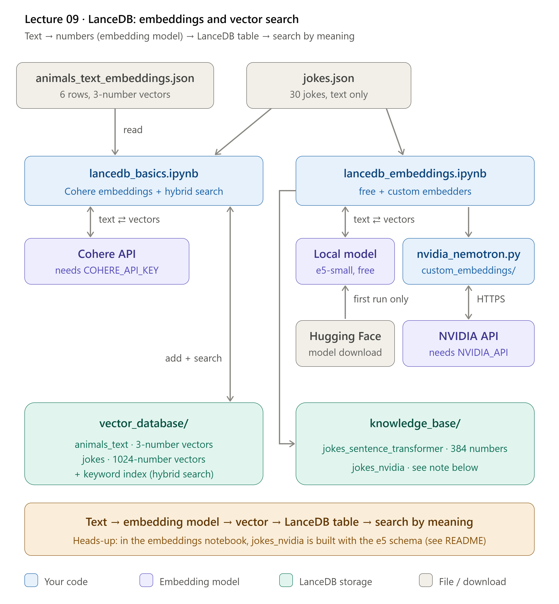

# LanceDB to be used as vector database


- [Video: Part 1 | LanceDB Basics](https://youtu.be/pQMEhbrXT4A)
- [Video: Part 2 | LanceDM Custom Embeddings](https://youtu.be/GDJuPBRn7aM)

Until now the agents only knew what the model learned in training. **LanceDB** is a database where you can store your **own text** as lists of numbers (**vectors**) and then ask "which stored texts are closest in **meaning** to my question?". This is the building block for **RAG** (next lectures): find the right text first, then give it to the model.



## 1. What the picture says

| In the picture | In the folder | Job |
| --- | --- | --- |
| **animals_text_embeddings.json** | [animals_text_embeddings.json](animals_text_embeddings.json) | 6 animal sentences with hand-made 3-number vectors, to learn vector search with no AI model |
| **jokes.json** | [jokes.json](jokes.json) | 30 short jokes (text only). The "documents" we embed and search |
| **lancedb_basics.ipynb** | [lancedb_basics.ipynb](lancedb_basics.ipynb) | Part 1: connect, tables, vector search, Cohere embeddings, hybrid search |
| **lancedb_embeddings.ipynb** | [lancedb_embeddings.ipynb](lancedb_embeddings.ipynb) | Part 2: a free local embedding model and a custom NVIDIA one |
| **nvidia_nemotron.py** | [custom_embeddings/nvidia_nemotron.py](custom_embeddings/nvidia_nemotron.py) | Our own embedding class that calls the NVIDIA API |
| **Cohere API / Local model / NVIDIA API** | outside your code | The models that turn text into numbers |
| **vector_database/**, **knowledge_base/** | created by the notebooks when you run them | The LanceDB databases (just folders on disk) |

> **Why do this?** A normal database finds rows by exact words. A vector database finds rows by **meaning**: "give me chemistry jokes" finds the joke about an atom even if the word "chemistry" is not in it.

## 2. The key ideas in one table

| Word | Meaning | In this lecture |
| --- | --- | --- |
| **Vector** | A list of numbers that stands for the meaning of a text | `[0.12, 0.85, 0.33]` (3 numbers, hand-made) or 1024 numbers (real model) |
| **Embedding** | The act of turning a text into a vector | `table.add(...)` and `table.search("text")` do it for you |
| **Embedding model** | The AI model that does the embedding | Cohere, `intfloat/multilingual-e5-small`, NVIDIA Nemotron |
| **Dimensions** | How many numbers one vector has. Fixed per model | 3, 384, 1024, 4096 |
| **Table** | Rows with columns, like SQL. Here: a text column and a vector column | `animals_text`, `jokes` |
| **Distance** | How far apart two vectors are. **Smaller = more similar** | the `_distance` column in search results |
| **Vector search** | Find the rows whose vectors are nearest to the query's vector | `table.search(...)` |
| **FTS** (full-text search) | Classic keyword search over an index of words | `create_fts_index("joke")` |
| **Hybrid search** | Vector search + FTS, merged into one ranking | `query_type="hybrid"` |
| **Reranker / RRF** | The step that merges the two lists. RRF scores each row by its rank in each list | `rerankers.RRFReranker()` |

## 3. Three ways to get vectors (what changes between the cells)

| | **Hand-made** | **Cohere** | **Local model** | **NVIDIA (custom)** |
| --- | --- | --- | --- | --- |
| Where | the JSON file | Cohere's servers | your computer | NVIDIA's servers |
| Model | none | `embed-multilingual-light-v3.0` | `intfloat/multilingual-e5-small` | `nvidia/nemotron-3.5-embed-8b` |
| Vector size | 3 | 1024 | 384 | 4096 |
| Key in `.env` | none | `COHERE_API_KEY` | none | `NVIDIA_API` |
| Cost | free | API quota | free (downloads the model once) | API quota |
| Used in | basics, steps 2-4 | basics, steps 5-8 | embeddings, steps 2-3 | embeddings, steps 4-5 |
| Written by | you | built into LanceDB | built into LanceDB | [nvidia_nemotron.py](custom_embeddings/nvidia_nemotron.py) |

## 4. How the files depend on each other

```
animals_text_embeddings.json ─┐
jokes.json ───────────────────┼──► lancedb_basics.ipynb ──► vector_database/   (made when you run it)
                              │
jokes.json ───────────────────┴──► lancedb_embeddings.ipynb ──► knowledge_base/  (made when you run it)
                                         ▲
custom_embeddings/nvidia_nemotron.py ────┘   imported in the "Custom embedder" cell
        │
        └──► reads NVIDIA_API from .env, calls the NVIDIA API
```

| Dependency | What it means |
| --- | --- |
| `lancedb_basics.ipynb` **needs** both JSON files and `COHERE_API_KEY` | It does not use `custom_embeddings/` |
| `lancedb_embeddings.ipynb` **needs** `jokes.json` and, for the last part, `custom_embeddings/nvidia_nemotron.py` | Start the notebook from this folder so `from custom_embeddings...` is found |
| `nvidia_nemotron.py` **needs** `NVIDIA_API` in `.env` | It is a leaf file: nothing else of ours is imported |
| The two notebooks are **independent** | Different databases (`vector_database/` vs `knowledge_base/`). Run them in any order |

## 5. How a run works

**Notebook 1: `lancedb_basics.ipynb`**

| Step | Part | What happens |
| --- | --- | --- |
| 1 | Connect | `lancedb.connect("vector_database")` creates the folder |
| 2 | Create a table | The animals JSON becomes the table `animals_text`. `add()` appends 2 more rows (version 1, then 2) |
| 3 | Empty table | A `LanceModel` describes columns only. Create, list and drop the demo table `jokes` |
| 4 | Vector search | `search([0.5, 0.2, 0.9]).limit(3)`: panda, cheetah, elephant are closest |
| 5 | Embeddings API | A schema with `SourceField` (text in) and `VectorField` (vector out). Table `jokes` |
| 6 | Add jokes | `add(df)`: LanceDB sends each joke to Cohere and stores the 1024 numbers |
| 7 | Text search | `search("give me chemistry related jokes")`: the query is embedded too, then nearest rows win |
| 8 | Hybrid search | `create_fts_index` then `query_type="hybrid"` and `.rerank(RRFReranker())` |

**Notebook 2: `lancedb_embeddings.ipynb`**

| Step | Part | What happens |
| --- | --- | --- |
| 1 | Set-up | Read `jokes.json` with pandas, connect to `knowledge_base` |
| 2 | Local model | `get_registry().get("sentence-transformers")`: free, runs on CPU. Table `jokes_sentence_transformer` |
| 3 | Search | English and a non-English query ("kemi") both work: the model is multilingual |
| 4 | Custom model | Import `nvidia_nemotron.py` (this registers it as `"nvidia-nemotron"`), then `get_registry().get("nvidia-nemotron").create()` |
| 5 | NVIDIA table | A new schema `NvidiaJokeModel` tied to the NVIDIA embedder, then table `jokes_nvidia` (4096 numbers per joke) |

## 6. Which search should I use?

| Your question looks like... | Use | Why |
| --- | --- | --- |
| An exact word, name or code ("C#") | **FTS** | Keywords match exactly |
| A idea, said in any words ("jokes about nature") | **Vector search** | Matches meaning, not spelling |
| Unpredictable or mixed | **Hybrid** | Gets the best of both |

## 7. What is in this folder

| File | What it is | Read it when you want to know... |
| --- | --- | --- |
| [lancedb_basics.ipynb](lancedb_basics.ipynb) | Part 1 notebook | How LanceDB works, step by step |
| [lancedb_embeddings.ipynb](lancedb_embeddings.ipynb) | Part 2 notebook | How to switch the embedding model, and how to write your own |
| [custom_embeddings/nvidia_nemotron.py](custom_embeddings/nvidia_nemotron.py) | Custom embedder | How to teach LanceDB a new embedding provider |
| [animals_text_embeddings.json](animals_text_embeddings.json) | 6 rows with tiny vectors | What a "row with a vector" looks like |
| [jokes.json](jokes.json) | 30 jokes | The data we search |
| [STUDY_GUIDE.md](STUDY_GUIDE.md) | Study guide | Everything explained for a beginner |
| `vector_database/`, `knowledge_base/` | Databases (appear after you run the notebooks) | Each table is a folder `<name>.lance/` with `_transactions`, `_versions` and `data` |

## Setup 

```bash
uv add lancedb sentence-transformers cohere
```

> The original line said `sentence-transformer` (no `s` at the end). The package is called `sentence-transformers`. `cohere` is the library behind the Cohere embeddings. They are already added to `pyproject.toml` (run `uv sync` on a fresh clone to install them). The `openai` and `python-dotenv` packages come with `pydantic-ai`.

You need to put in this into your .env 

```env
COHERE_API_KEY=YOUR_API_KEY
```

Paste in your api key from cohere - [create it here](https://dashboard.cohere.com/api-keys)

For the custom NVIDIA embedder (part 2) also add the key you already use in the other lectures:

```env
NVIDIA_API=YOUR_NVIDIA_KEY
```

## 8. Run it

1. Open the notebook in VS Code and pick the project's `.venv` as the kernel.
2. The notebooks look for their files in **this folder**, so keep them here.
3. Run the cells top to bottom. The first run of the local model downloads it from Hugging Face (a few seconds to minutes).
4. When you are done, look at the new folders `vector_database/` and `knowledge_base/`. You can delete them to start from scratch.

## 9. Known quirks

Fixed in the notebooks (kept here so you know what to watch for in your own code):

| Was | Fix |
| --- | --- |
| `jokes_nvidia` was built with `JokeModel`, which belongs to the **local** model, so NVIDIA was never called | The notebook now defines `NvidiaJokeModel` with `embedding_model.SourceField()` and `VectorField()` |
| The last cell searched `table` instead of `table_jokes` | It now searches `table_jokes` (the NVIDIA table) |
| The markdown said "sentence-transformer" but the code uses Cohere | Markdown corrected |
| `open("jokes.json", "r")` failed on Windows (`UnicodeDecodeError`) | Now `encoding="utf-8"` |
| `lancedb`, `sentence-transformers`, `cohere` missing from `pyproject.toml` | Added with `uv add` |
| `vector_database/` and `knowledge_base/` not in `.gitignore` | Added |

Still true:

| # | Quirk | Where | Effect |
| --- | --- | --- | --- |
| 1 | Text column is `joke` in one notebook and `jokes` in the other | both notebooks | The column name in the schema must match the DataFrame column |
| 2 | No `load_dotenv()` in the notebooks | both notebooks | `COHERE_API_KEY` must already be in your environment (add `load_dotenv()` if you get a missing key error) |
| 3 | `db.table_names()` is deprecated | [lancedb_basics.ipynb](lancedb_basics.ipynb) | Works, but prints a warning. Use `db.list_tables()` |
| 4 | `create_table("jokes_sentence_transformer", ...)` has no `exist_ok` | [lancedb_embeddings.ipynb](lancedb_embeddings.ipynb) | Running the cell twice fails because the table already exists |
| 5 | NVIDIA embedding is one API call per text | [custom_embeddings/nvidia_nemotron.py](custom_embeddings/nvidia_nemotron.py) | Fine for 30 jokes, slow for thousands |
| 6 | The saved outputs come from the lecturer's Mac, and the NVIDIA table cells were changed after they were saved | notebooks | Paths like `/Users/aigineer/...` are not yours. Re-run the cells to refresh the outputs |

## Read more
- [lancedb docs](https://lancedb.com/docs/)
- [lancedb quickstart](https://lancedb.com/docs/quickstart/)
- [lancedb working with tables](https://lancedb.com/docs/tables/)
- [lancedb vector search](https://lancedb.com/docs/search/vector-search/)
- [lancedb embeddings](https://lancedb.com/docs/embedding/)
- [lancedb reranking](https://lancedb.com/docs/reranking/)
- [lancedb hybrid search](https://lancedb.com/docs/search/hybrid-search/)

Earlier lectures

- [Lecture 08: Logfire](../08_logfire/README.md): the previous lecture
- [Lecture 03: Structured output](../03_pydanticai_structured_output/): Pydantic models, the idea behind `LanceModel`

## Other videos
