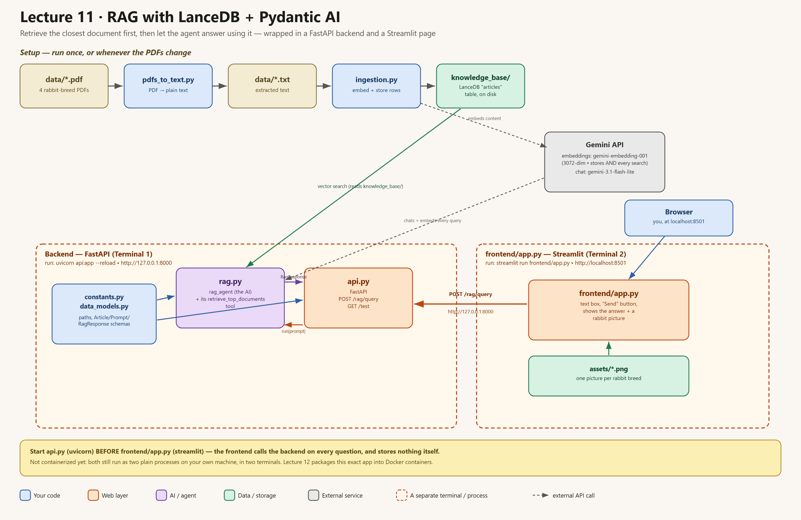

# Study guide: 11 RAG (Retrieval-Augmented Generation with LanceDB + Pydantic AI)

| When you are reading... | Read this section |
| --- | --- |
| The big idea | [1. The 30-second version](#1-the-30-second-version) |
| How all the files connect | [2. The pictures](#2-the-pictures-to-understand) |
| Why retrieval is a "tool", not a manual search | [3.1](#31-retrieval-is-a-tool-the-agent-calls-itself) |
| Reusing lecture 09's embedding ideas | [3.2](#32-the-schema-is-the-same-idea-as-lecture-09-reused) |
| `constants.py`, `data_models.py` | [4.1](#41-constantspy--shared-paths) and [4.2](#42-data_modelspy--the-shared-shapes) |
| `pdfs_to_text.py`, `ingestion.py` | [4.3](#43-pdfs_to_textpy--pdf-to-txt) and [4.4](#44-ingestionpy--txt-to-vector-database) |
| `rag.py`, `api.py`, `app.py` | [4.5](#45-ragpy--the-agent-and-its-tool), [4.6](#46-apipy--the-front-door), [4.7](#47-apppy--the-page) |
| `explorations.ipynb` | [5. The notebook](#5-the-notebook-explorationsipynb) |
| How to actually run this project | [6. Running it](#6-running-it) |
| Things that will actually break for you | [7. Gotchas](#7-gotchas-and-things-to-watch-for) |

---

## 1. The 30-second version

Lecture 09 taught you how to store text as vectors in LanceDB and search them. Lecture 05 taught you how to split an AI app into a Streamlit page and a FastAPI backend. **This lecture combines both, plus the "tool" idea from lecture 06**, into a working RAG app:

1. Turn 4 PDFs about rabbit breeds into plain text (`pdfs_to_text.py`).
2. Embed that text and store it in a LanceDB table (`ingestion.py`), reusing the `Article` schema from `data_models.py`.
3. Give the AI agent a **tool** it can call on its own: "search the knowledge base" (`rag.py`). The agent decides when to call it.
4. Wrap the agent behind a FastAPI endpoint (`api.py`) and a Streamlit page (`app.py`), exactly like lecture 05's frontend/backend split.

| New in 11 | In one sentence | Where in the code |
| --- | --- | --- |
| **RAG** | Retrieval-Augmented Generation: look things up *before* answering, instead of only trusting what the model already knows | the whole lecture |
| **A retrieval tool** | A Python function the agent can call mid-reasoning to search the vector database | `retrieve_top_documents` in `rag.py` |
| **Forced structured output** | The agent's final answer must fill in a specific Pydantic shape, not free text | `output_type=RagResponse` in `rag.py` |
| **One shared schema for storing *and* querying** | `Article` (storage shape) is defined once and reused by both the ingestion script and the search tool | `data_models.py` |

> **Data engineer view:** this is a small **ETL + serving** pipeline. `pdfs_to_text.py` and `ingestion.py` are the batch ETL job (extract → transform/embed → load into LanceDB). `rag.py` + `api.py` + `app.py` are the serving layer that reads from what the ETL built.

---

## 2. The pictures to understand



### Picture A: how the files connect (the whole pipeline)

```
data/*.pdf ──► pdfs_to_text.py ──► data/*.txt ──► ingestion.py ──► knowledge_base/ (LanceDB)
                                                        │                   ▲
                                                        │ uses              │ searched by
                                                        ▼                   │
                                              backend/data_models.py ──► backend/rag.py ──► api.py ──► frontend/app.py
                                                        ▲                                      ▲
                                                        │                                      │
                                              backend/constants.py ──────────────────────── (both import paths)
```

- `constants.py` and `data_models.py` sit *underneath* the pipeline — almost every other file imports a path or a schema from one of them.
- `pdfs_to_text.py` and `ingestion.py` are **one-time (or re-run-when-docs-change) jobs** you run from the terminal. They are not part of the live app.
- `rag.py` → `api.py` → `app.py` is the **live app**: three layers, same shape as lecture 05's frontend/backend split, with LanceDB (lecture 09) sitting underneath `rag.py` instead of nothing.

### Picture B: one question, step by step

```
1. You type "what does a Holland Lop look like?" in app.py and click Send.
2. app.py:  requests.post("http://127.0.0.1:8000/rag/query", json={"prompt": text})
3. api.py:  FastAPI validates the body against Prompt, then calls rag_agent.run(query.prompt)
4. rag.py:  the LLM reads the question and system prompt, and DECIDES to call its tool:
               retrieve_top_documents(query="Holland Lop appearance")
5. rag.py:  vector_db["articles"].search(query=...).limit(3).to_list()
               → LanceDB embeds the query text with the SAME embedding_model from data_models.py
               → compares it to every stored embedding, returns the closest rows
6. rag.py:  the tool returns the top document's filename/filepath/content as one text block
7. rag.py:  the LLM reads that text and writes its final answer, forced into RagResponse
               (filename, filepath, answer)
8. api.py:  returns result.output as JSON
9. app.py:  shows the answer, the source filepath, and an image at assets/{filename}.png
```

**The key difference from lecture 09:** in lecture 09 *you* called `table.search(...)` by hand, in a notebook cell. Here, the **AI model itself** decides whether and when to call it, and with what query text. You never call `retrieve_top_documents` directly — the agent does.

### Picture C: what ingestion actually builds

```
Dwarf_Hotot.pdf  ──extract_text_from_pdf()──►  "Dwarf Hotot\nCountry of origin\n..."  ──export_text_to_txt()──►  dwarf_hotot.txt

dwarf_hotot.txt  ──ingest_docs_to_vector_db()──►  row added to the "articles" table:
    doc_id = "dwarf_hotot"
    file_path = str(file)          <-- declared in the Article schema (data_models.py)
    filename = "dwarf_hotot"
    content  = "Dwarf Hotot\n..."
    embedding = [... numbers, generated automatically from content ...]
```

Four PDFs in, four rows in the `"articles"` table. The `rag_agent`'s tool searches across exactly those rows.

---

## 3. Ideas worth understanding

### 3.1 Retrieval is a **tool** the agent calls itself

```python
@rag_agent.tool_plain
def retrieve_top_documents(query: str, k=3) -> str:
    ...
```

This is the exact mechanism from lecture 06 (`06_tool_use`): a decorator registers a plain Python function as something the LLM is allowed to call mid-conversation. The agent, not you, decides:
- *whether* to call it at all (it might answer from the system prompt alone if it thought it already knew),
- *what text* to pass as `query` (it rewrites your question into whatever search text it thinks will retrieve the best match).

That is the "A" in RAG: **A**ugmented — the model's own reasoning decides when to augment itself with retrieved facts, instead of you always running a fixed search before every call.

### 3.2 The schema is the same idea as lecture 09, reused

In lecture 09, `JokeModel` had `SourceField()`/`VectorField()` so `table.add(df)` would auto-embed. `Article` in `data_models.py` does the identical thing. The difference is that here, the *same* `embedding_model` object that embeds stored documents (`ingestion.py`, via `SourceField`) is implicitly reused by `vector_db["articles"].search(query=...)` inside `rag.py`'s tool — LanceDB knows, from the table's own metadata, which embedding function to re-run on a search string. That's why `rag.py` never constructs an `embedding_model` itself — it only needs the already-built table.

### 3.3 Forced structured output, again

`output_type=RagResponse` (lecture 03's idea) means the LLM's final reply is **not** free text — Pydantic AI keeps asking the model (up to `retries=2` times) until it produces something that fits `RagResponse` exactly: `filename`, `filepath`, `answer`. This is what lets `app.py` safely do `data["answer"]`, `data["filepath"]`, `data["filename"]` without checking the shape itself.

### 3.4 Frontend/backend split, again (lecture 05)

`app.py` never imports `rag_agent` directly — only `api.py` does. `app.py` only knows an HTTP address and a JSON shape, exactly like lecture 05's `frontend.py`/`api.py` split. You must run `api.py` (uvicorn) **before** `app.py` (Streamlit), for the same reason as lecture 05.

---

## 4. The files

### 4.1 `constants.py` — shared paths

[constants.py](backend/constants.py)

| Line | Code | Meaning |
| --- | --- | --- |
| 12 | `DATA_PATH = Path(__file__).parents[1] / "data"` | `backend/constants.py` → up one level (`parents[1]`) → `11_rag/` → into `data/`. Holds the PDFs and, after `pdfs_to_text.py` runs, the `.txt` files too |
| 17 | `VECTOR_DATABASE_PATH = Path(__file__).parents[1] / "knowledge_base"` | Where the LanceDB database folder lives, same pattern |

Both constants are imported, never retyped, by every script that needs a path (`pdfs_to_text.py`, `ingestion.py`, `rag.py`, the notebook).

### 4.2 `data_models.py` — the shared shapes

[data_models.py](backend/data_models.py)

| Lines | Name | What it defines |
| --- | --- | --- |
| 22 | `embedding_model` | Registers Google's Gemini embedding model (`"gemini-text"` / `"gemini-embedding-001"`) with LanceDB, once, at import time |
| 26 | `EMBEDDING_DIM = 3072` | The vector length this project *declares* it will store (see [7. Gotchas](#7-gotchas-and-things-to-watch-for) — this is one to check) |
| 29–46 | `class Article(LanceModel)` | The storage shape: `doc_id`, `file_path`, `filename`, `content` (the `SourceField`), `embedding` (the `VectorField`) |
| 48–55 | `class Prompt(BaseModel)` | What `api.py` expects in the request body: `{"prompt": "..."}` |
| 58–67 | `class RagResponse(BaseModel)` | What the agent's final answer must look like: `filename`, `filepath`, `answer` |

**Worth noticing:** `Article` uses the field name `file_path` (line 37), but `RagResponse` uses `filepath` (line 65) — one word, no underscore. They are two *different* classes describing two *different* things (a stored document vs. an agent's answer), so they're allowed to disagree... except `ingestion.py` and `rag.py` both still write/read a dict key spelled `filepath` when talking about `Article` rows. See [7. Gotchas](#7-gotchas-and-things-to-watch-for) #1.

### 4.3 `pdfs_to_text.py` — PDF to `.txt`

[pdfs_to_text.py](pdfs_to_text.py)

| Lines | Code | Meaning |
| --- | --- | --- |
| 9–22 | `extract_text_from_pdf(path)` | Reads a PDF page by page with `pypdf`, concatenates whatever text each page has |
| 25–30 | `export_text_to_txt(text, export_path)` | Writes a string to a `.txt` file, overwriting if it exists |
| 34–40 | `if __name__ == "__main__":` | For every PDF in `DATA_PATH`, extract its text and save it as `<same_stem>.txt`, lower-cased, next to the PDF |

Run it from inside `11_rag/` with `python pdfs_to_text.py` (the file sits at the top level of `11_rag/`, not inside `backend/` — see [7. Gotchas](#7-gotchas-and-things-to-watch-for) #4 about the run-command comment inside the file itself).

### 4.4 `ingestion.py` — `.txt` to vector database

[ingestion.py](ingestion.py)

| Lines | Code | Meaning |
| --- | --- | --- |
| 12–20 | `setup_vector_db(path)` | Creates the `knowledge_base` folder if missing, connects LanceDB, creates the `"articles"` table from the `Article` schema (`exist_ok=True`, safe to re-run) |
| 28–37 | loop start | For every `.txt` file: read its content, compute `doc_id` from the filename, delete any existing row with that `doc_id` (so re-running doesn't duplicate) |
| 39–52 | `table.add([{...}])` | Insert one row. **No `embedding` key** — LanceDB calls `embedding_model` on `content` automatically, because `Article.content` is a `SourceField()` |
| 56 | `time.sleep(30)` | Pause between documents to stay under the embedding API's rate limit |
| 60–63 | `if __name__ == "__main__":` | Build the table, then ingest every `.txt` file |

This is the script that actually talks to the embedding API and fills the database `rag.py` later searches.

### 4.5 `rag.py` — the agent and its tool

[rag.py](backend/rag.py)

| Lines | Code | Meaning |
| --- | --- | --- |
| 14 | `vector_db = lancedb.connect(uri=VECTOR_DATABASE_PATH)` | Opens the database `ingestion.py` built. Runs once, at import |
| 20–33 | `rag_agent = Agent(...)` | Builds the agent **once**, reused for every question: which model (`gemini-2.5-flash`), how many retries, the system prompt (five instruction strings — a tuple of strings is a valid way to pass several system prompts at once), and `output_type=RagResponse` |
| 39–40 | `@rag_agent.tool_plain` / `def retrieve_top_documents(query: str, k=3) -> str:` | Registers the function as a tool the agent can call. See [3.1](#31-retrieval-is-a-tool-the-agent-calls-itself) |
| 50 | `vector_db["articles"].search(query=query).limit(k).to_list()` | Vector search: embeds `query`, returns the `k` closest rows as a list of dicts |
| 55–63 | the `return f"""..."""` | Builds the text handed back to the LLM, using `results[0]` only |

**Worth noticing (two things to check yourself):**
- Line 50 asks for `k=3` results, but line 59 only ever reads `results[0]` — the single closest match. The other two are fetched and thrown away.
- Line 59 reads `results[0]["filepath"]`, but the schema field (4.2, line 37) is named `file_path`. See [7. Gotchas](#7-gotchas-and-things-to-watch-for) #1.

### 4.6 `api.py` — the front door

[api.py](api.py)

| Lines | Code | Meaning |
| --- | --- | --- |
| 17–19 | `@app.get("/test")` | Health check |
| 26–35 | `@app.post("/rag/query")` / `async def query_documentation(query: Prompt):` | FastAPI validates the body against `Prompt`, then `await rag_agent.run(query.prompt)`, then returns `result.output` (a `RagResponse`, turned into JSON automatically) |

Same shape as lecture 05's `api.py`: a thin layer that validates, hands off to the agent, and returns the answer. No AI logic of its own.

### 4.7 `app.py` — the page

[app.py](frontend/app.py)

| Lines | Code | Meaning |
| --- | --- | --- |
| 12 | `ASSETS_PATH = Path(__file__).absolute().parents[1] / "assets"` | `frontend/app.py` → up one level → `11_rag/` → into `assets/` |
| 24–26 | `requests.post("http://127.0.0.1:8000/rag/query", json={"prompt": text_input})` | Calls `api.py`, which must already be running |
| 39 | `st.markdown(data["filepath"])` | Reads the `RagResponse.filepath` field (consistent — this one's fine) |
| 43 | `st.image(ASSETS_PATH / f"{data['filename']}.png")` | Looks up a breed image by the name the agent returned. See [7. Gotchas](#7-gotchas-and-things-to-watch-for) #3 — one breed's image filename doesn't match |

---

## 5. The notebook `explorations.ipynb`

A scratchpad: the same two halves as the pipeline, run cell by cell so you can see each step's output before trusting it as a script.

| Cell | Shows | Matches which script |
| --- | --- | --- |
| `# Read pdfs` + the function cell | Copies of `extract_text_from_pdf` / `export_text_to_txt` | `pdfs_to_text.py` |
| `list(data_path.glob("*.pdf"))` | The 4 PDFs found | — |
| The conversion loop | Writes the 4 `.txt` files | `pdfs_to_text.py`'s `__main__` block |
| `## Explore knowledge base` | — | marks the switch from "build" to "look around" |
| `lancedb.connect(...)` + `db.table_names()` | Confirms the `"articles"` table exists | connects to what `ingestion.py` built |
| `db["articles"].to_pandas()` | All 4 rows, including the `embedding` column | — |
| `db["articles"].schema` | The column types, including `embedding: fixed_size_list<item: float>[3072]` and the `embedding_functions` metadata | ties back to `EMBEDDING_DIM` in `data_models.py` |

Every cell already has a markdown explanation above it in the notebook itself — open [explorations.ipynb](explorations.ipynb) and read top to bottom.

**One thing worth testing for yourself:** the saved output under `db["articles"].schema` shows `filepath: string not null` (no underscore) and `[3072]`. That output is left over from the lecturer's own earlier run, from *before* this project's `Article.file_path` rename and before you've run `ingestion.py` yourself — your own run may not match it exactly (see the gotchas below).

---

## 6. Running it

There is no README in this folder yet, so here is the order implied by the code itself. Run everything from inside `11_rag/`.

**One-time setup:**

```bash
uv add pypdf
```

(`pypdf` is imported by `pdfs_to_text.py` but isn't yet in this project's dependencies — see gotcha #2 below.)

**Build the knowledge base (run once, or whenever the PDFs change):**

```bash
python pdfs_to_text.py
```

```bash
python ingestion.py
```

**Run the live app (two terminals):**

```bash
uvicorn api:app --reload
```

```bash
streamlit run frontend/app.py
```

| Check | Address |
| --- | --- |
| Backend test page | `http://127.0.0.1:8000/docs` |
| The RAGbit page | the address Streamlit prints (usually `http://localhost:8501`) |

Start the API **before** the Streamlit page, same reason as lecture 05: `app.py` calls `api.py` on every question.

---

## 7. Gotchas and things to watch for

These are things I found by actually reading the installed `lancedb==0.41.0` source, `pyproject.toml`, `.env`, and the `assets/` folder next to this code — not guesses. None of them have been triggered yet in this repo (there's no `knowledge_base/` folder and no `.txt` files here yet), so treat this as a checklist for your **first** real run, and good practice at reading error messages.

| # | What to watch for | Why | Where |
| --- | --- | --- | --- |
| 1 | **Field name mismatch: `file_path` vs `filepath`.** `Article` declares `file_path` (required, no default), but `ingestion.py` inserts a dict with the key `"filepath"`, and `rag.py`'s tool reads `results[0]["filepath"]`. | `table.add(...)` will likely complain about a missing required field (`file_path`) and/or an unexpected one (`filepath`). Pick **one** spelling and use it everywhere: the `Article` class, the dict in `ingestion.py` line 43, and the dict lookup in `rag.py` line 59. | `data_models.py:37`, `ingestion.py:43`, `rag.py:59` |
| 2 | **`pypdf` isn't installed or declared.** It's not in `pyproject.toml`'s dependencies and isn't in `.venv`. | `python pdfs_to_text.py` will fail immediately with `ModuleNotFoundError: No module named 'pypdf'`. | `pdfs_to_text.py:5`, run `uv add pypdf` |
| 3 | **One breed's image filename doesn't match.** The PDF `Netherland_Dwarf_rabbit.pdf` produces `doc_id`/`filename` = `netherland_dwarf_rabbit`, but the image in `assets/` is named `netherland_dwarf.png` (no `_rabbit`). | If the agent ever answers using that document, `st.image(ASSETS_PATH / f"{data['filename']}.png")` in `app.py` will raise a file-not-found error. | `assets/netherland_dwarf.png` vs. the PDF's stem |
| 4 | **The run-command comments are wrong.** Both `pdfs_to_text.py` and `ingestion.py` have a comment saying `python -m backend.pdfs_to_text` / `python -m backend.ingestion`, but both files actually live at the top level of `11_rag/`, not inside `backend/`. | Those exact commands would fail with `No module named backend.pdfs_to_text`. Run `python pdfs_to_text.py` and `python ingestion.py` instead (from inside `11_rag/`). | `pdfs_to_text.py:33`, `ingestion.py:59` |
| 5 | **`.env` doesn't have `GOOGLE_API_KEY`.** The LanceDB `"gemini-text"` embedder (used in `data_models.py`) specifically reads `os.environ.get("GOOGLE_API_KEY")` — I checked this in the installed `lancedb` package itself. This repo's `.env`/`.env.example` only define `Gemini_API_Key` (a different name, not just different casing). | `ingestion.py` (and anything else that triggers an embedding) will fail to authenticate until a variable literally named `GOOGLE_API_KEY=...` exists in `.env`. The chat model in `rag.py` is a separate concern (Pydantic AI accepts `GOOGLE_API_KEY` or `GEMINI_API_KEY`), so that part may behave differently — test each half separately if something fails. | `.env`, `data_models.py:22` |
| 6 | **`EMBEDDING_DIM = 3072` is hand-typed, not asked from the model.** The installed LanceDB `"gemini-text"` embedder's `ndims()` returns **768** by default — it only returns something else if you pass `dim=...` when creating it (`get_registry().get("gemini-text").create(name="gemini-embedding-001", dim=3072)`). Right now the code never passes `dim`. | If the model actually embeds at 768 numbers but the `Article.embedding` column is declared `Vector(3072)`, adding a row can fail or behave unexpectedly. Try printing `embedding_model.ndims()` yourself (in the notebook or a scratch cell) before trusting `3072`. | `data_models.py:22,26,46` |
| 7 | **`retrieve_top_documents` only ever uses the best match.** `k=3` documents are fetched, but only `results[0]` is used in the return string. The other two are wasted work. Decide if that's intentional (simplest possible RAG) or something to fix as practice (e.g. loop over all `k` and concatenate them). | `rag.py:50-63` |
| 8 | **No `.gitignore` entries yet for this lecture's generated folders.** Lecture 09 added `09_lancedb/vector_database/` and `09_lancedb/knowledge_base/` to `.gitignore`. This lecture's `11_rag/data/*.txt` and `11_rag/knowledge_base/` aren't excluded yet, so a careless `git add -A` could commit generated data. | `.gitignore` |

**How to verify these for yourself** (good practice, rather than taking the table above on faith):
- Gotcha 6: run `print(embedding_model.ndims())` right after the import in `data_models.py` or in a notebook cell — compare it with `EMBEDDING_DIM`.
- Gotcha 1 and 3: these will show up as a crash with a clear Python error the moment you run `ingestion.py` or click "Send" on a question about the Netherland Dwarf.

---

## 8. Glossary (new or reused words in 11)

| Term | Meaning |
| --- | --- |
| **RAG (Retrieval-Augmented Generation)** | Search your own data first, then let the model answer using what was found |
| **Retrieval** | The "search" half of RAG — finding the relevant stored text |
| **Tool / `tool_plain`** | A Python function the LLM can choose to call during its own reasoning (lecture 06) |
| **`output_type`** | Forces the agent's final answer into a specific Pydantic shape (lecture 03) |
| **`SourceField` / `VectorField`** | Marks which schema column holds input text and which holds the generated vector (lecture 09) |
| **Embedding registry** | LanceDB's catalogue of embedding providers, `get_registry().get("name")` (lecture 09) |
| **`ndims()`** | How many numbers an embedding model outputs; must match the schema's `Vector(...)` length |
| **Stateless API** | `api.py` remembers nothing between requests — same idea as lecture 05 |
| **Decoupling** | Splitting the page (`app.py`) from the AI logic (`rag.py`/`api.py`) so either can change independently (lecture 05) |

---

## 9. Where this connects

- **Lecture 05** gave you the frontend/backend split this project reuses as-is (`app.py` ↔ `api.py`).
- **Lecture 06** gave you the "tool the agent calls itself" idea, now applied to search instead of a calculator or weather API.
- **Lecture 09** gave you LanceDB, embeddings, `SourceField`/`VectorField`, and the registry — this project is lecture 09's database wired into an agent for the first time.
- **Lecture 03** gave you forcing a model's output into a Pydantic shape (`output_type=RagResponse`).

---

## 10. My questions

Write your own questions here as you study, and answer them when you find out.

-
-
-
