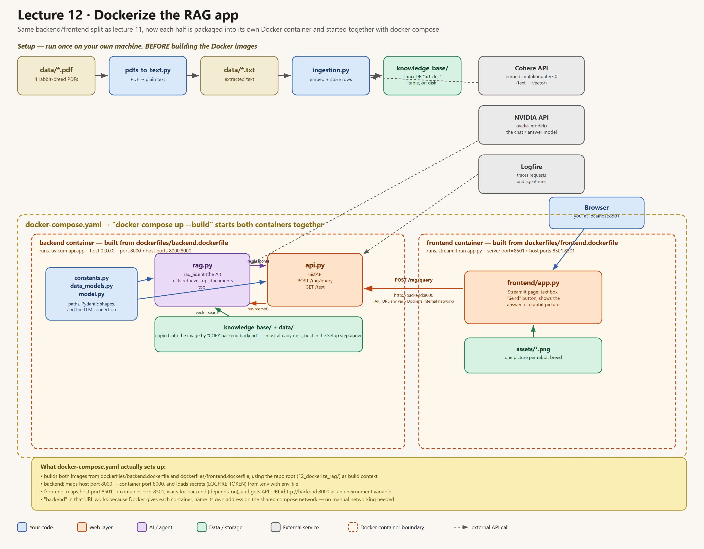

# Lecture 12: Dockerize the RAG app (FastAPI + Streamlit + Docker Compose)

- [Video Link](https://youtu.be/F2TmqZo8EUk)

Lecture 11 built a RAG app as two Python programs you ran yourself (`uvicorn` in one terminal, `streamlit` in another). This lecture doesn't change a single idea about *how the RAG app works* — it changes how it's **packaged and started**. We put the backend and the frontend into their own **Docker containers**, so instead of remembering two commands in two terminals, one `docker compose up --build` starts both, networked together, exactly the same way on any machine.



## 1. What the picture says

| In the picture | In the folder | Job |
| --- | --- | --- |
| **data/\*.pdf → pdfs_to_text.py → data/\*.txt → ingestion.py → knowledge_base/** | [backend/src/pdfs_to_text.py](backend/src/pdfs_to_text.py), [backend/src/ingestion.py](backend/src/ingestion.py) | The exact same ETL pipeline from lecture 11. Still run **once, locally, before you build the Docker images** — this lecture doesn't containerize it |
| **backend/src/backend/constants.py, data_models.py, model.py** | [backend/src/backend/](backend/src/backend) | Shared paths, Pydantic/LanceDB schemas, and the NVIDIA model connection — same jobs as lecture 11, reused as-is |
| **rag.py** | [backend/src/backend/rag.py](backend/src/backend/rag.py) | The `rag_agent` and its `retrieve_top_documents` tool |
| **api.py** | [backend/src/backend/api.py](backend/src/backend/api.py) | FastAPI app, `POST /rag/query`, wrapped with **Logfire** tracing |
| **backend container** | [dockerfiles/backend.dockerfile](dockerfiles/backend.dockerfile) | Packages the whole `backend/` folder, installs its dependencies with `uv`, and runs `uvicorn api:app` on port 8000 |
| **frontend/src/frontend/app.py** | [frontend/src/frontend/app.py](frontend/src/frontend/app.py) | The Streamlit page: text box, "Send" button, shows the answer and a matching rabbit picture from `assets/` |
| **frontend container** | [dockerfiles/frontend.dockerfile](dockerfiles/frontend.dockerfile) | Packages the `frontend/` folder and runs `streamlit run app.py` on port 8501 |
| **docker-compose.yaml** | [docker-compose.yaml](docker-compose.yaml) | Builds both images and starts both containers together, on a shared network where they can reach each other by name |

> **Why do this?** "Works on my machine" is the thing Docker fixes. A container bundles the code **and** its exact dependencies (Python version, packages) into one package that runs the same way on your laptop, a teammate's laptop, or a server — nobody has to separately install `uv`, Python 3.13, or the right versions of every package by hand.

## 2. How 12 differs from 11

| | **11 RAG** | **12 Dockerize RAG** |
| --- | --- | --- |
| New idea | Retrieval + an agent + a web app | **Packaging** that same app so it runs anywhere, the same way |
| How you start it | `uvicorn api:app` and `streamlit run app.py`, by hand, in two terminals | `docker compose up --build`, one command |
| Where the code runs | Directly on your machine, using your own Python/uv install | Inside two **containers** — isolated mini-computers built from a recipe |
| How the frontend finds the backend | `http://127.0.0.1:8000` (same machine) | `http://backend:8000` — Docker's internal network resolves `backend` to the right container |
| New files | — | `dockerfiles/backend.dockerfile`, `dockerfiles/frontend.dockerfile`, `docker-compose.yaml`, `.dockerignore` |
| New vocabulary | — | Image, container, Dockerfile, build context, `docker-compose.yaml`, `depends_on`, `env_file` |

## 3. What is in this folder

| File | What it is |
| --- | --- |
| [backend/src/backend/constants.py](backend/src/backend/constants.py) | `DATA_PATH`, `VECTOR_DATABASE_PATH` |
| [backend/src/backend/data_models.py](backend/src/backend/data_models.py) | `Article` (storage schema), `Prompt` (request shape), `RagResponse` (answer shape) |
| [backend/src/backend/model.py](backend/src/backend/model.py) | `nvidia_model()` — builds the LLM client `rag.py` uses |
| [backend/src/backend/rag.py](backend/src/backend/rag.py) | `rag_agent` and its `retrieve_top_documents` tool |
| [backend/src/backend/api.py](backend/src/backend/api.py) | FastAPI app: `GET /test`, `POST /rag/query`, Logfire instrumentation |
| [backend/src/pdfs_to_text.py](backend/src/pdfs_to_text.py) | PDF → `.txt`, run once before ingestion |
| [backend/src/ingestion.py](backend/src/ingestion.py) | `.txt` → LanceDB rows in `knowledge_base/` |
| [backend/src/data/](backend/src/data) | The 4 source PDFs (and, after step 1, their `.txt` versions) |
| [frontend/src/frontend/app.py](frontend/src/frontend/app.py) | The Streamlit page |
| [frontend/src/assets/](frontend/src/assets) | One picture per rabbit breed, named to match `RagResponse.filename` |
| [dockerfiles/backend.dockerfile](dockerfiles/backend.dockerfile) | Recipe for the backend image |
| [dockerfiles/frontend.dockerfile](dockerfiles/frontend.dockerfile) | Recipe for the frontend image |
| [docker-compose.yaml](docker-compose.yaml) | Builds and starts both containers together |
| [.dockerignore](.dockerignore) | Files excluded from the build context (keeps images smaller, build faster) |

## Setup

We take the base code from 11_rag but put it into two different packages so that we can separate installations for respective docker containers.

Start up a new project and then create two packages

```bash
uv init --no-package --python 3.13
uv init --package backend 
uv init --package frontend
```

Then add the dependencies in each of the `pyproject.toml`. You can take a look at the different pyprojects of this lecture. When that is done do 

```bash
uv sync --all-packages
```

## Logfire

To setup logfire 
1. create a project called ragbit
2. run this 
  
```bash
uv run logfire projects use ragbit
```

3. install logfire for fastapi 

```bash
uv add "logfire[fastapi]"
```

4. You also need to get a write token in logfire. Go into security and access -> write tokens -> new write token
5. Add it to your .env, which your docker-compose.yaml will inject into the running container. You need to name it LOGFIRE_TOKEN for logfire.configure() to automatically pick up

```bash
LOGFIRE_TOKEN=<your write token>
```

## 4. Running it

**Part 1 — build the knowledge base (run locally, not in Docker, once or whenever the PDFs change):**

> ⚠️ Before running these, make sure `backend/src/backend/custom_embeddings/nvidia_nemotron.py` exists (copy it from [09_lancedb/custom_embeddings/nvidia_nemotron.py](../09_lancedb/custom_embeddings/nvidia_nemotron.py), plus an empty `__init__.py` in that new folder). `data_models.py` imports it at the top of the file, so without it `ingestion.py` fails immediately with `ModuleNotFoundError: No module named 'backend.custom_embeddings'`. See gotcha #1 below.

```bash
cd backend/src
uv run python pdfs_to_text.py
uv run python ingestion.py
```

This has to happen **before** you build the backend image, because `backend.dockerfile` copies the whole `backend/` folder — including `data/` and `knowledge_base/` — into the image with `COPY backend backend`. If `knowledge_base/` doesn't exist yet, the container starts with an empty (or missing) database.

**Part 2 — build and start both containers:**

```bash
docker compose up --build
```

| Check | Address |
| --- | --- |
| Backend test page | `http://127.0.0.1:8000/docs` |
| The RAGbit page | `http://127.0.0.1:8501` |

Docker Compose builds the backend image (installs dependencies with `uv sync`, starts `uvicorn`) and the frontend image (installs dependencies, starts `streamlit`), and connects them on a private network where the frontend can reach the backend at `http://backend:8000` — the hostname `backend` comes directly from `container_name: backend` in [docker-compose.yaml](docker-compose.yaml).

## 5. Gotchas and things to double-check

These are things worth testing for yourself the first time you actually run this, rather than guesses:

| # | What to watch for | Why |
| --- | --- | --- |
| 1 | **`backend/src/backend/custom_embeddings/` doesn't exist in this folder yet.** `data_models.py` imports `nvidia_nemotron` from it at the top of the file. | `ingestion.py`, `rag.py`, and `api.py` all import `data_models` (directly or transitively), so none of them will even start until this file exists here. Copy it from [09_lancedb/custom_embeddings/nvidia_nemotron.py](../09_lancedb/custom_embeddings/nvidia_nemotron.py) plus an `__init__.py` — see the [STUDY_GUIDE](STUDY_GUIDE.md#34-data_modelspy-imports-a-file-this-folder-doesnt-have-yet) for why it only needs to *import* cleanly, not actually be used (Cohere does the real embedding here) |
| 2 | `backend.dockerfile`'s `WORKDIR /app/backend/src/backend` is where `uv sync` runs, but a `uv init --package backend` project's `pyproject.toml` normally lives at `backend/pyproject.toml` (one level up), not inside `backend/src/backend/`. | If `uv sync --no-dev` can't find a `pyproject.toml` from that folder, the build will fail — check which folder actually holds `pyproject.toml` in your project and adjust `WORKDIR` if needed |
| 3 | `frontend/app.py`'s `BASE_URL` default already ends in `/rag/query`, and the request line appends `/rag/query` again (`requests.post(f"{BASE_URL}/rag/query", ...)`) | Only lines up correctly when `API_URL` is set to `http://backend:8000` (no path) by docker-compose. Running the frontend locally without Docker, against the documented default, would hit a doubled path and 404 |
| 4 | `knowledge_base/` must exist (built by Part 1 above) before `docker compose up --build`, since `rag.py` connects to it the moment it's imported | Starting the backend container without having run `ingestion.py` first means `vector_db["articles"]` won't find a table |
| 5 | `.env` needs `NVIDIA_API` (exactly that name — confirmed in `model.py`, matches `../.env.example`) and `LOGFIRE_TOKEN` for the backend. `env_file: .env` only applies to the **backend** service in [docker-compose.yaml](docker-compose.yaml), not the frontend | The frontend container never sees your `.env` values directly — it only gets `API_URL`, set explicitly under `environment:` |

## Read more
- [Docker docs: Dockerfile reference](https://docs.docker.com/reference/dockerfile/)
- [Docker Compose docs](https://docs.docker.com/compose/)
- [uv docs: Working on projects](https://docs.astral.sh/uv/guides/projects/)

Earlier lecture
- [Lecture 11: RAG](../11_rag/README.md): the agent, the ingestion pipeline, and the FastAPI/Streamlit split this lecture packages into containers
