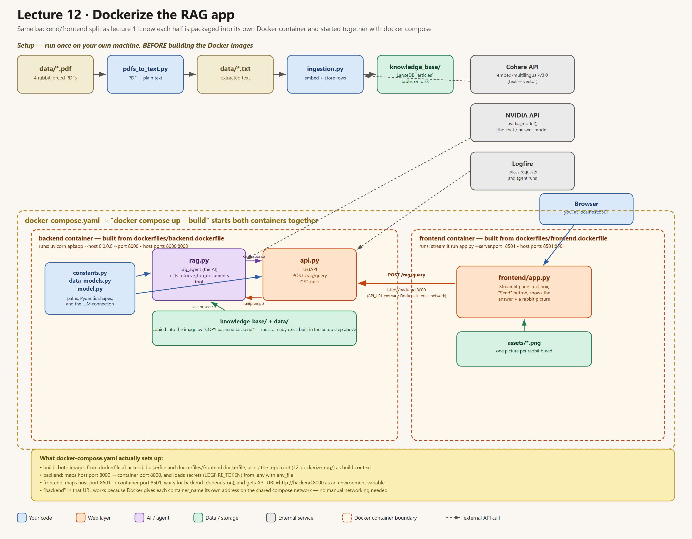

# Study guide: 12 Dockerize RAG (packaging lecture 11 into containers)

| When you are reading... | Read this section |
| --- | --- |
| The big idea | [1. The 30-second version](#1-the-30-second-version) |
| How all the pieces connect | [2. The picture](#2-the-picture-to-understand) |
| Why the ETL step is NOT containerized | [3.1](#31-the-pdf--vector-pipeline-stays-outside-docker) |
| What a Dockerfile's lines actually do | [3.2](#32-reading-a-dockerfile-line-by-line) |
| Why `http://backend:8000` works | [3.3](#33-container-networking-why-backend8000-resolves) |
| `constants.py`, `data_models.py`, `model.py` | [4.1](#41-constantspy), [4.2](#42-data_modelspy), [4.3](#43-modelpy) |
| `pdfs_to_text.py`, `ingestion.py` | [4.4](#44-pdfs_to_textpy) and [4.5](#45-ingestionpy) |
| `rag.py`, `api.py`, `app.py` | [4.6](#46-ragpy), [4.7](#47-apipy), [4.8](#48-frontendapppy) |
| `backend.dockerfile`, `frontend.dockerfile`, `docker-compose.yaml` | [5. The Docker layer](#5-the-docker-layer) |
| How to actually run this project | [6. Running it](#6-running-it) |
| Things that will likely trip you up | [7. Gotchas](#7-gotchas-and-things-to-watch-for) |

---

## 1. The 30-second version

Lecture 11 gave you a working RAG app made of two Python programs you had to start yourself, in the right order, in two terminals. This lecture changes **nothing about the AI logic** — `rag.py`, `api.py`, `app.py` are the same ideas as lecture 11, just reused with NVIDIA/Cohere instead of Gemini. What's new is **packaging**:

1. Each half (`backend/`, `frontend/`) becomes its own **Docker image** — a snapshot containing the code, the right Python version, and every dependency, built from a recipe called a **Dockerfile**.
2. `docker-compose.yaml` describes how to build both images and run them together as **containers** — running instances of those images — on a private network where they can find each other by name.
3. One command, `docker compose up --build`, replaces "open two terminals and remember two commands."

| New in 12 | In one sentence | Where in the code |
| --- | --- | --- |
| **Image** | A packaged, read-only snapshot of code + dependencies + OS layer | built by `docker build`, described by a `.dockerfile` |
| **Container** | A running instance of an image — like a lightweight, isolated computer | started by `docker compose up` |
| **Dockerfile** | A step-by-step recipe for building one image | [dockerfiles/backend.dockerfile](dockerfiles/backend.dockerfile), [dockerfiles/frontend.dockerfile](dockerfiles/frontend.dockerfile) |
| **Build context** | The folder's contents available to `COPY` while building | `context: .` in `docker-compose.yaml` — the whole `12_dockerize_rag/` folder |
| **Container networking** | Containers started together by Compose can reach each other by `container_name`, like a hostname | `API_URL=http://backend:8000` |

> **Data engineer view:** this is the difference between a script that runs "on your laptop, today" and a deployable **artifact** — the same image can be handed to a teammate, pushed to a registry, or run on a server, and it behaves identically every time because the environment is baked in, not assumed.

---

## 2. The picture to understand



```
Setup (run once, locally — NOT inside Docker)
1  backend/src/data/*.pdf   ──[pdfs_to_text.py]──►  backend/src/data/*.txt
2  backend/src/data/*.txt   ──[ingestion.py]──►      backend/src/knowledge_base/  (LanceDB)

Build + start (docker compose up --build)
3  docker-compose.yaml  ──builds──►  backend image   (dockerfiles/backend.dockerfile)
4  docker-compose.yaml  ──builds──►  frontend image  (dockerfiles/frontend.dockerfile)
5  both containers start, joined on one compose network

Query (every time you ask a question)
6  frontend/app.py (Streamlit, :8501)  ──POST /rag/query──►  http://backend:8000
7  api.py  ──►  rag_agent.run(prompt)  ──►  retrieve_top_documents()  ──►  knowledge_base/
8  rag_agent  ──►  RagResponse{filename, filepath, answer}  ──►  api.py  ──►  Streamlit shows it
```

Steps 6-8 are **identical** to lecture 11 — only *where* `api.py` and `app.py` are running has changed (inside containers, talking over a Docker network, instead of two processes on your own OS talking over `127.0.0.1`).

---

## 3. Ideas worth understanding

### 3.1 The PDF → vector pipeline stays **outside** Docker

Look at `backend.dockerfile`: it only `COPY`s the `backend/` folder and installs dependencies — it never runs `pdfs_to_text.py` or `ingestion.py`. That means:

- `knowledge_base/` must already exist **on your machine**, built by running those two scripts yourself, **before** `docker compose up --build`.
- When the image is built, `COPY backend backend` copies whatever is already sitting in `backend/src/data/` and `backend/src/knowledge_base/` at that moment — PDFs, extracted `.txt` files, and the LanceDB folder — straight into the image.
- If you change the PDFs later, you need to re-run the pipeline **and** rebuild the image (`docker compose up --build` again) for the container to see the new data. Docker doesn't know your PDFs changed; it only knows what was in the build context last time you built.

This is a deliberate, common pattern: **build-time data** (rarely-changing reference data) gets baked into the image, while a database you expect to grow quickly would instead usually live in a mounted volume or an external service — something to notice, not necessarily something to fix in this lecture.

### 3.2 Reading a Dockerfile, line by line

Every line in a Dockerfile is an instruction that adds a new layer to the image:

| Instruction | What it does |
| --- | --- |
| `FROM python:3.13-slim` | Start from an existing image that already has Python 3.13 installed |
| `WORKDIR /app/...` | Set the "current folder" inside the image for every instruction after it |
| `COPY <local> <in-image>` | Copy files from the build context (your machine) into the image |
| `ENV NAME=value` | Set an environment variable that exists inside every container made from this image |
| `RUN <command>` | Execute a shell command **while building** the image (e.g. installing packages) |
| `CMD [...]` | The command that runs when a container **starts** — not during the build |

Both Dockerfiles in this lecture follow the exact same five-instruction shape; only the folder name (`backend`/`frontend`) and the final `CMD` (`uvicorn` vs `streamlit`) differ.

### 3.3 Container networking: why `backend:8000` resolves

Inside `docker-compose.yaml`, each service has a `container_name` (`backend`, `frontend`). Compose creates a private network for the services it starts together, and on that network, **a container's name works as its hostname** — the same way `google.com` resolves to an IP address on the public internet. That's the entire reason `frontend/app.py` can reach the backend at `http://backend:8000` instead of needing an IP address, a port forward, or `127.0.0.1` (which, *inside* the frontend container, would mean "this container," not the backend one).

Compare this to lecture 11, where both programs ran directly on your OS and shared `127.0.0.1` as "this machine" — that shortcut doesn't exist once each program is isolated inside its own container.

### 3.4 `data_models.py` imports a file this folder doesn't have yet

[data_models.py line 23](backend/src/backend/data_models.py) has:

```python
from backend.custom_embeddings import nvidia_nemotron  # noqa
```

This is the exact same "register a custom embedder as a side effect of importing it" trick from lecture 09 — but `nvidia_nemotron.py` lives in [09_lancedb/custom_embeddings/](../09_lancedb/custom_embeddings/nvidia_nemotron.py), and there's no `backend/src/backend/custom_embeddings/` folder in **this** lecture yet. See [gotcha #1](#7-gotchas-and-things-to-watch-for) — this isn't a maybe, it will crash on import until you add the file.

Worth noticing once you fix it: the line only registers `"nvidia-nemotron"` with LanceDB's registry. The `embedding_model` actually used on [line 32](backend/src/backend/data_models.py) is `get_registry().get("cohere")` — Cohere, not NVIDIA. So this import has to succeed for the module to load at all, but the NVIDIA embedder it registers isn't the one doing any work here; NVIDIA is only used for the **chat model** in `model.py`, while Cohere does the **embeddings**.

---

## 4. The files

### 4.1 `constants.py`

[constants.py](backend/src/backend/constants.py)

| Line | Code | Meaning |
| --- | --- | --- |
| 20 | `DATA_PATH = Path(__file__).parents[1] / "data"` | `backend/src/backend/constants.py` → up one level (`parents[1]`) → `backend/src/` → into `data/` |
| 23 | `VECTOR_DATABASE_PATH = Path(__file__).parents[1] / "knowledge_base"` | Same pattern, points at `backend/src/knowledge_base/` |

### 4.2 `data_models.py`

[data_models.py](backend/src/backend/data_models.py)

| Lines | Name | What it defines |
| --- | --- | --- |
| 23 | `from backend.custom_embeddings import nvidia_nemotron` | Side-effect import — see [3.4](#34-data_modelspy-imports-a-file-this-folder-doesnt-have-yet) |
| 32 | `embedding_model` | Registers Cohere's `embed-multilingual-v3.0` with LanceDB, once, at import time — this is the embedder actually used |
| 35-54 | `class Article(LanceModel)` | The storage shape: `doc_id`, `filepath`, `filename`, `content` (the `SourceField`), `embedding` (the `VectorField`) |
| 57-62 | `class Prompt(BaseModel)` | What `api.py` expects in the request body: `{"prompt": "..."}` |
| 65-75 | `class RagResponse(BaseModel)` | What the agent's final answer must look like: `filename`, `filepath`, `answer` |

### 4.3 `model.py`

[model.py](backend/src/backend/model.py)

| Lines | Code | Meaning |
| --- | --- | --- |
| 18-20 | `def nvidia_model(model_name="nvidia/nemotron-3.5-super-vl-120b-a12b")` | Default chat model, overridable by argument |
| 21-26 | `OpenAIChatModel(... provider=OpenAIProvider(base_url="https://integrate.api.nvidia.com/v1", api_key=os.environ["NVIDIA_API"]))` | NVIDIA's API speaks the OpenAI protocol, so `pydantic_ai`'s OpenAI classes work against it with a different `base_url`. The key name must be exactly `NVIDIA_API` in `.env` — confirmed against `.env.example` at the repo root |

### 4.4 `pdfs_to_text.py`

[pdfs_to_text.py](backend/src/pdfs_to_text.py)

| Lines | Code | Meaning |
| --- | --- | --- |
| 9-30 | `extract_text_from_pdf(path)` | Reads a PDF page by page with `pypdf`, concatenates whatever text each page has |
| 33-36 | `export_text_to_txt(text, export_path)` | Writes a string to a `.txt` file, overwriting if it exists |
| 43-53 | `if __name__ == "__main__":` | For every PDF in `DATA_PATH`, extract its text and save it as `<same_stem, lowercased>.txt` next to it |

Imports only `backend.constants`, not `backend.data_models` — so this one script is unaffected by the missing `custom_embeddings` module (gotcha #1); it's the one piece of the pipeline you can run right now.

### 4.5 `ingestion.py`

[ingestion.py](backend/src/ingestion.py)

| Lines | Code | Meaning |
| --- | --- | --- |
| 13-25 | `setup_vector_db(path)` | Creates the `knowledge_base` folder if missing, connects LanceDB, creates the `"articles"` table from the `Article` schema (`exist_ok=True`, safe to re-run) |
| 33-42 | loop start | For every `.txt` file: read its content, compute `doc_id` from the filename, delete any existing row with that `doc_id` (so re-running doesn't duplicate) |
| 47-56 | `table.add([{...}])` | Insert one row with key `"filepath"` — matching `Article.filepath` exactly (no mismatch here, unlike lecture 11's early draft). **No `embedding` key** — LanceDB calls `embedding_model` on `content` automatically |
| 63 | `time.sleep(10)` | Pause between documents to stay under the embedding API's rate limit |
| 69-71 | `if __name__ == "__main__":` | Build the table, then ingest every `.txt` file |

### 4.6 `rag.py`

[rag.py](backend/src/backend/rag.py)

| Lines | Code | Meaning |
| --- | --- | --- |
| 15 | `vector_db = lancedb.connect(uri=VECTOR_DATABASE_PATH)` | Opens the database `ingestion.py` built. Runs once, at import |
| 21-33 | `rag_agent = Agent(...)` | Built once, reused for every question: `nvidia_model()`, a 30s timeout, 1 retry, a five-string system prompt, and `output_type=RagResponse` |
| 39-40 | `@rag_agent.tool_plain` / `def retrieve_top_documents(query: str) -> str:` | Registers the function as a tool the agent can call on its own — the lecture 06 pattern |
| 48 | `vector_db["articles"].search(query=query).to_list()` | Vector search: embeds `query` with the same Cohere embedder, returns matches as a list of dicts |
| 50-56 | the `return f"""..."""` | Only `results[0]` (the single closest match) is read and handed back to the LLM |

### 4.7 `api.py`

[api.py](backend/src/backend/api.py)

| Lines | Code | Meaning |
| --- | --- | --- |
| 17-19 | `logfire.configure()` / `instrument_pydantic_ai()` / `instrument_fastapi(app)` | Wires up tracing for every AI run and every HTTP request |
| 22-28 | `@app.get("/test")` | Health check: visit it, expect `{"test": "hello"}` |
| 31-43 | `@app.post("/rag/query")` / `async def query_documentation(query: Prompt):` | FastAPI validates the body against `Prompt`, then `await rag_agent.run(query.prompt)`, then returns `result.output` (a `RagResponse`, turned into JSON automatically) |

Same shape as lecture 11's `api.py`: a thin layer that validates, hands off to the agent, and returns the answer.

### 4.8 `frontend/app.py`

[app.py](frontend/src/frontend/app.py)

| Lines | Code | Meaning |
| --- | --- | --- |
| 16 | `BASE_URL = os.getenv("API_URL", default="http://127.0.0.1:8000/rag/query")` | Default already includes the path — see [gotcha #2](#7-gotchas-and-things-to-watch-for) |
| 19 | `ASSETS_PATH = Path(__file__).absolute().parents[1] / "assets"` | `frontend/src/frontend/app.py` → up one level → `frontend/src/` → into `assets/` |
| 38 | `requests.post(f"{BASE_URL}/rag/query", json={"prompt": text_input})` | Appends `/rag/query` **again** — only correct when `API_URL` has no path, i.e. inside Docker |
| 53 | `st.image(ASSETS_PATH / f"{data.get('filename')}.png")` | Looks up a breed picture by the name the agent returned |

---

## 5. The Docker layer

### 5.1 `dockerfiles/backend.dockerfile`

[backend.dockerfile](dockerfiles/backend.dockerfile)

| Line | Code | Meaning |
| --- | --- | --- |
| 1 | `FROM python:3.13-slim` | Small base image with Python 3.13 |
| 2 | `WORKDIR /app/` | Everything below happens inside `/app/` |
| 3 | `COPY backend backend` | Copies the whole local `backend/` folder (code, data, and — once you've run the setup pipeline — `knowledge_base/`) into the image |
| 4 | `ENV PYTHONPATH=/app/backend` | Makes `backend` importable as a top-level package |
| 5 | `RUN pip install --no-cache-dir uv` | Installs `uv`, the dependency manager this project uses |
| 6 | `WORKDIR /app/backend/src/backend` | Moves into the folder containing `api.py` before the next command — see [gotcha #3](#7-gotchas-and-things-to-watch-for) about whether `uv sync` can find `pyproject.toml` from here |
| 7 | `RUN uv sync --no-dev` | Installs the backend's dependencies |
| 8 | `CMD [...]` | Starts `uvicorn api:app` on `0.0.0.0:8000` when the container runs |

### 5.2 `dockerfiles/frontend.dockerfile`

[frontend.dockerfile](dockerfiles/frontend.dockerfile)

Same shape as 5.1, pointed at `frontend/` instead of `backend/`, ending with:

```dockerfile
CMD [ "uv" , "run", "streamlit", "run", "app.py", "--server.port=8501", "--server.address=0.0.0.0"]
```

`--server.address=0.0.0.0` is the Streamlit equivalent of `uvicorn`'s `--host 0.0.0.0`: without it, the app would only accept connections from *inside* its own container, and the port mapping in `docker-compose.yaml` wouldn't be able to reach it.

### 5.3 `docker-compose.yaml`

[docker-compose.yaml](docker-compose.yaml)

| Lines | Code | Meaning |
| --- | --- | --- |
| 2-12 | `backend:` service | `container_name: backend`, builds from `dockerfiles/backend.dockerfile` with the repo folder as build context, maps host port 8000 to container port 8000, loads `.env` as environment variables |
| 15-27 | `frontend:` service | `container_name: frontend`, builds from `dockerfiles/frontend.dockerfile`, maps host port 8501 to container port 8501, `depends_on: backend` (start order, not a readiness check), and sets `API_URL=http://backend:8000` directly |

**Worth noticing:** `env_file: .env` appears only under `backend`. The frontend service gets **no** access to your `.env` secrets — it only receives the one variable explicitly listed under its own `environment:` key.

---

## 6. Running it

Run everything from inside `12_dockerize_rag/`.

**Part 1 — one-time setup, before Docker is involved at all:**

```bash
uv sync --all-packages
```

Add a `backend/src/backend/custom_embeddings/nvidia_nemotron.py` (copy it from [09_lancedb/custom_embeddings/nvidia_nemotron.py](../09_lancedb/custom_embeddings/nvidia_nemotron.py) plus an empty `__init__.py` in that new folder) — see [gotcha #1](#7-gotchas-and-things-to-watch-for). Without it, the next two commands fail at `import backend.data_models`.

```bash
cd backend/src
uv run python pdfs_to_text.py
uv run python ingestion.py
```

**Part 2 — build and start both containers:**

```bash
cd ../..
docker compose up --build
```

| Check | Address |
| --- | --- |
| Backend interactive docs | `http://127.0.0.1:8000/docs` |
| The RAGbit page | `http://127.0.0.1:8501` |

**Stopping it:**

```bash
docker compose down
```

---

## 7. Gotchas and things to watch for

| # | What to watch for | Why | Where |
| --- | --- | --- | --- |
| 1 | **`backend/src/backend/custom_embeddings/` doesn't exist in this folder.** `data_models.py` imports `nvidia_nemotron` from it at the top of the file. | `import backend.data_models` raises `ModuleNotFoundError: No module named 'backend.custom_embeddings'` — and `ingestion.py`, `rag.py`, and therefore `api.py` all import `data_models` transitively, so **nothing in the pipeline runs** until this file exists here. Copy it from [09_lancedb/custom_embeddings/nvidia_nemotron.py](../09_lancedb/custom_embeddings/nvidia_nemotron.py) plus an `__init__.py`. | `data_models.py:23` |
| 2 | `frontend/app.py`'s `BASE_URL` default already ends in `/rag/query`, and the POST call appends `/rag/query` again | Fine inside Docker (where `API_URL=http://backend:8000`, no path), but doubles up if you ever run the frontend locally against the file's own default | `app.py:16` and `app.py:38` |
| 3 | `backend.dockerfile`'s `WORKDIR` before `uv sync` is `/app/backend/src/backend` — two levels deeper than where `uv init --package backend` normally puts `pyproject.toml` (`backend/pyproject.toml`) | If `uv sync --no-dev` can't find a `pyproject.toml` to read from that folder, the **image build itself** fails. Worth testing on your first `docker compose up --build`; if it fails here, try moving `WORKDIR` up to `/app/backend` | `backend.dockerfile:6` |
| 4 | `depends_on: backend` only waits for the backend **container to start**, not for `uvicorn` inside it to finish starting up and be ready for requests | A question sent the instant the frontend loads could hit a backend that's still booting; usually sorts itself out since the frontend only sends a request after you click "Send" | `docker-compose.yaml:23-24` |
| 5 | `knowledge_base/` and `data/*.txt` are **not generated by Docker** — see [3.1](#31-the-pdf--vector-pipeline-stays-outside-docker) | Forgetting Part 1 of [6. Running it](#6-running-it) means the backend container starts with no documents to retrieve from | — |
| 6 | No `.gitignore` entries yet for `backend/src/data/*.txt` or `backend/src/knowledge_base/` in this folder | A careless `git add -A` could commit generated data/vectors | `.gitignore` |

---

## 8. Glossary (new or reused words in 12)

| Term | Meaning |
| --- | --- |
| **Image** | A built, read-only snapshot of code + dependencies, made from a Dockerfile |
| **Container** | A running instance of an image |
| **Dockerfile** | The recipe (`FROM`, `COPY`, `RUN`, `CMD`, ...) used to build one image |
| **Build context** | The set of local files Docker is allowed to `COPY` from while building (`context: .`) |
| **Layer** | Each Dockerfile instruction adds one cached layer to the image, which is why instructions that change rarely (like `RUN pip install uv`) are usually placed before ones that change often |
| **`docker-compose.yaml`** | Describes multiple services (containers) to build and run together, plus how they're networked |
| **`depends_on`** | Controls start **order** between services, not readiness |
| **`env_file` vs `environment`** | `env_file` loads a whole `.env` file as variables; `environment` sets specific variables by hand, directly in the YAML |
| **Container networking** | Services in the same `docker-compose.yaml` can reach each other by `container_name`, acting as a hostname |
| **Port mapping (`"8000:8000"`)** | `host_port:container_port` — makes a container's port reachable from your own machine |

---

## 9. Where this connects

- **Lecture 11** gave you the agent, the retrieval tool, and the FastAPI/Streamlit split this lecture packages — nothing about `rag.py`, `api.py`, or `app.py`'s own logic changes here.
- **Lecture 09** gave you LanceDB, embeddings, and the `nvidia_nemotron.py` custom embedder — reused by reference here, and the missing copy of that file is this lecture's gotcha #1.
- **Lecture 06** gave you the "tool the agent calls itself" idea (`@rag_agent.tool_plain`), reused unchanged in `rag.py`.

---

## 10. My questions

Write your own questions here as you study, and answer them when you find out.

-
-
-
