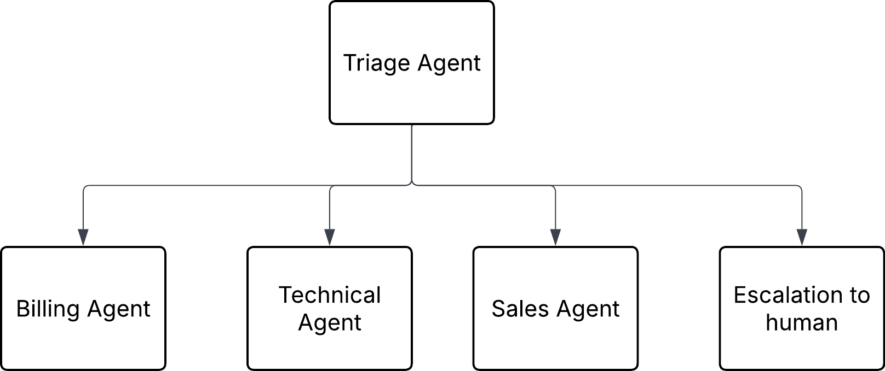

# Exercise 2 - Multiagent

In this exercise you get to continue your PydanticAI journey to include 
- tools 
- multi-agent 
- logfire monitoring

## 0. Multiagent triaging 

Create a multiagent system that looks like this:

Add logging, monitoring and prompt management in logfire. Also create relevant evals and LLM judges to evaluate your system. Can you also modify your system to prevent prompt injection such as misleading it to say stuffs it's not intended to say?